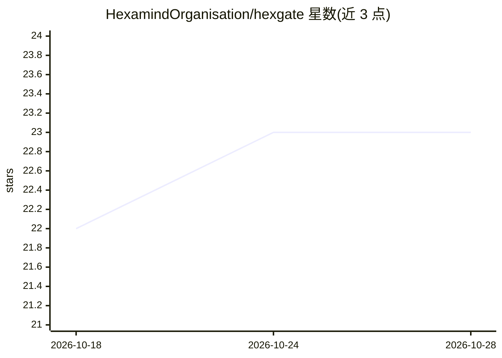

# HexamindOrganisation/hexgate

⭐ 23 · Python · MIT · 推送 2026-10-28 · [GitHub](https://github.com/HexamindOrganisation/hexgate) · [官网](https://hexgate.ai) · 组织维护

**AI agent 工具调用的运行时授权与审计 SDK**

面向 AI agent 开发者的 Python 授权基础设施：在每次工具调用时依据调用者角色与参数做出 allow/deny/approval-required 的类型化 Decision，决策记录进审计日志。提供框架适配器（OpenAI Agents、LangChain/LangGraph、Google ADK、Pydantic AI）以包裹既有 agent，支持本地 YAML/WASM bundle 离线运行，或接入可选的 Hexgate 平台（FastAPI 控制面 + React 面板，云托管或自托管）下发签名 WASM 策略。策略可在无模型、无 API key 的情况下离线测试。

## 筛选速览

| 维度 | 判定 | 备注 |
|---|---|---|
| AI 角色 | `ai-ecosystem` | LLM/agent 周边工具 |
| 许可风险 | `permissive` | MIT |
| 部署形态 | `library` | 以包/库形式分发 |
| 模型依赖 | — | README 未给出锁定关系 |
| 硬件要求 | — | 无带数字的原话,不猜 |
| 安装摩擦 | `medium` | 含编译或系统依赖之一 |
| 成熟度 | — | 结构信号不足 |

## 能力要点

- 每次工具调用产出类型化 Decision（allow/deny/approval-required）并写入审计日志
- 支持 OpenAI Agents、LangChain/LangGraph、Google ADK、Pydantic AI 框架适配
- 本地 YAML/WASM bundle 模式无需平台与 API key，可离线测试策略
- 支持将 MCP server 包装为策略受控工具，biscuit 令牌衰减传递调用者身份

## 适用场景

- 给已上线的 agent 加一层按用户角色限制工具调用与参数的授权
- 满足需要留痕的审批流：敏感操作强制人工批准并记录审计日志
- 在浏览器里编辑策略、签发项目级令牌并推送签名 WASM 策略到生产

## 场景标签

 · 领域:AI agent 基础设施/安全

## 证据(README 行号)

> L5: **Runtime authorization for AI agents.**
> L22: - **`hexgate` — the SDK.** A Python runtime that gates every tool call through a typed `Decision` (allow / deny / a
> L65: |Framework adapters|OpenAI Agents, LangChain/LangGraph, Google ADK, Pydantic AI.|

## 星数曲线

2026-10-18 22 → 2026-10-28 23（+1）

---
*卡片 v1 · prompt 1.4 · 生成 2026-10-27 · 置信度 high · 依据 README sha `167856a2fbec` · [字段定义](../../DATASET.md)*
