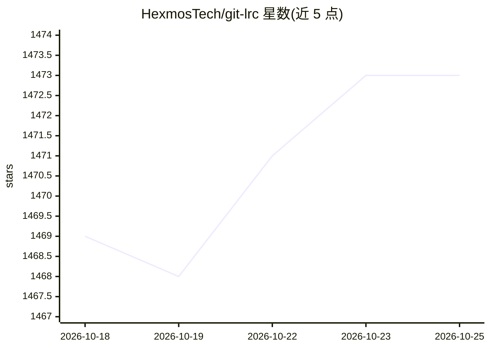

# HexmosTech/git-lrc

⭐ 1,475 · Go · NOASSERTION · 推送 2026-10-23 · [GitHub](https://github.com/HexmosTech/git-lrc) · [官网](https://hexmos.com/livereview/git-lrc/) · 组织维护

**挂在 git commit 上的 AI 代码审查工具：提交前自动审查 diff**

git-lrc 在 git commit 环节插入 AI 审查钩子：提交前对 diff 运行 AI 评审，覆盖 10 个风险类别与 100+ 失败模式，产出带严重度的行内评论、风险评分视图与变更摘要幻灯片。支持自动(commit 触发)与手动(git lrc review)两种模式，提供 vouch(人工担保)/skip(跳过)与面向编码代理和 CI 的 --agent-mode(非交互、JSON 输出)。安装附带 claude-lrc，可在 Claude Code 内以斜杠命令执行同一流程。设置需 LiveReview API key 与 Gemini API key，免费层每月 30k 行代码。

## 筛选速览

| 维度 | 判定 | 备注 |
|---|---|---|
| AI 角色 | `ai-native` | 本体是模型或模型工具 |
| 许可风险 | `none` | NOASSERTION |
| 部署形态 | `None` |  |
| 模型依赖 | — | README 未给出锁定关系 |
| 硬件要求 | — | 无带数字的原话,不猜 |
| 安装摩擦 | `low` | 无编译、无系统依赖或容器化 |
| 成熟度 | — | 结构信号不足 |

## 能力要点

- commit 时自动对 diff 运行 AI 审查（10 风险类别、100+ 失败模式）
- Issue Navigator 按类别/严重度/区域过滤审查发现
- --agent-mode 非交互 JSON 输出，供编码代理与 CI 使用
- vouch/skip 决策与迭代次数、覆盖率被记录到 git log

## 适用场景

- AI 代理生成代码后在提交前拦截泄露凭据、逻辑删除等问题
- 在 Claude Code 等编码代理流程中嵌入自动化审查
- 通过风险评分视图优先处理大 diff 中的高风险变更

## 场景标签

`代码审查` · 领域:编码与开发

## 证据(README 行号)

> L18: **`git-lrc` is your braking system.** It hooks into `git commit` and runs an AI review on every diff _before_ it la
> L158: # review launches automatically before the commit goes through
> L241: git lrc review --agent-mode

## 星数曲线

2026-10-18 1,469 → 2026-10-25 1,473（+4）

---
*卡片 v1 · prompt 1.4 · 生成 2026-10-21 · 置信度 high · 依据 README sha `9f98ffa4eca5` · [字段定义](../../DATASET.md)*
