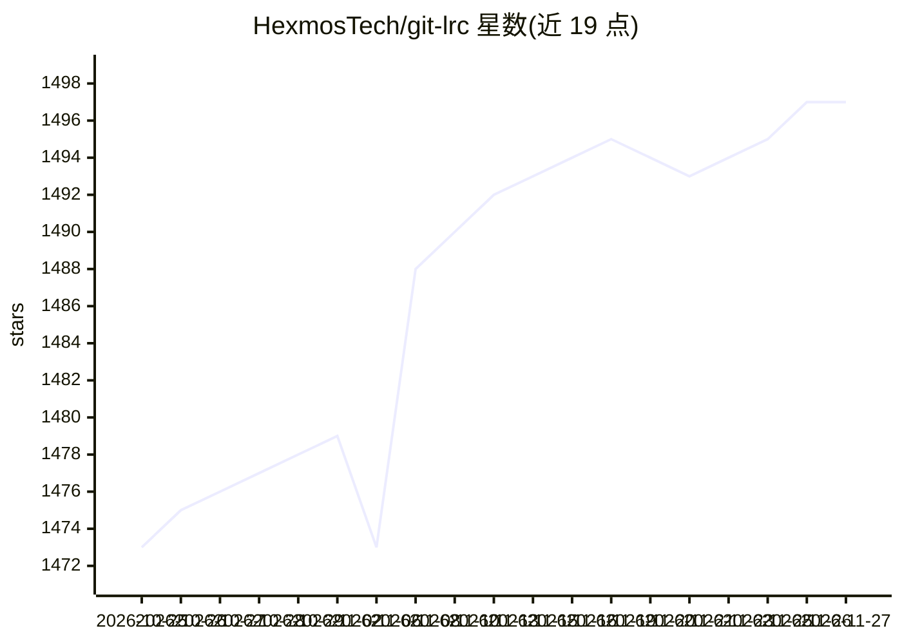

# HexmosTech/git-lrc

⭐ 1,497 · Go · NOASSERTION · 推送 2026-11-24 · [GitHub](https://github.com/HexmosTech/git-lrc) · [官网](https://hexmos.com/livereview/git-lrc/) · 组织维护

**Git 提交时自动运行 AI 代码审查的钩子工具**

git-lrc 以钩子形式挂接 git commit，在每次提交落库前对暂存 diff 运行 AI 审查，覆盖 10 个风险类别与 100+ 失败模式（凭据泄漏、云成本、错误处理等）。审查结果在浏览器 UI 中以行内评论、严重度徽章与风险评分视图呈现，支持迭代/人工担保（vouch）/跳过（skip）三种决策，并生成摘要幻灯片。提供 claude-lrc 作为 Claude Code 内的 slash 命令形态，以及面向 CI 与编码代理的 --agent-mode JSON 非交互输出。免费层每月 30k LOC，Premium 从 $32/100k LOC 起，企业版支持自托管。

## 筛选速览

| 维度 | 判定 | 备注 |
|---|---|---|
| AI 角色 | `ai-native` | 本体是模型或模型工具 |
| 许可风险 | `none` | NOASSERTION |
| 部署形态 | `self-host` | docker 或自建部署 |
| 模型依赖 | — | README 未给出锁定关系 |
| 硬件要求 | — | 无带数字的原话,不猜 |
| 安装摩擦 | `low` | 无编译、无系统依赖或容器化 |
| 成熟度 | — | 结构信号不足 |

## 能力要点

- 钩入 git commit，提交前自动运行 AI 审查，10 类风险、100+ 失败模式
- 三种决策路径：AI 迭代审查、人工 vouch、skip，git log 记录覆盖统计
- claude-lrc 在 Claude Code 内提供 /lrc:review 等 slash 命令
- --agent-mode 面向编码代理/CI 输出 JSON，写入 agent-reviewed 凭证

## 适用场景

- 用 AI 代理生成代码后，提交前自动拦截凭据泄漏、错误逻辑等问题
- 把审查发现复制回代理修复，迭代直至满意再 vouch 提交
- CI 或编码代理流水线中非交互运行审查并输出 JSON 结果
- 新工程师通过摘要幻灯片快速了解每次变更的内容与风险

## 场景标签

`代码审查` · 领域:编码与开发

## 证据(README 行号)

> L18: **`git-lrc` is your braking system.** It hooks into `git commit` and runs an AI review on every diff _before_ it la
> L135: 2. **Free Gemini API key** — grab one from Google AI Studio
> L236: browser-based review UI. `--agent-mode` runs a real AI review non-interactively

## 星数曲线

2026-10-25 1,473 → 2026-11-27 1,497（+24）

---
*卡片 v1 · prompt 1.4 · 生成 2026-11-26 · 置信度 mid · 依据 README sha `e5d2cca0210d` · [字段定义](../../DATASET.md)*
