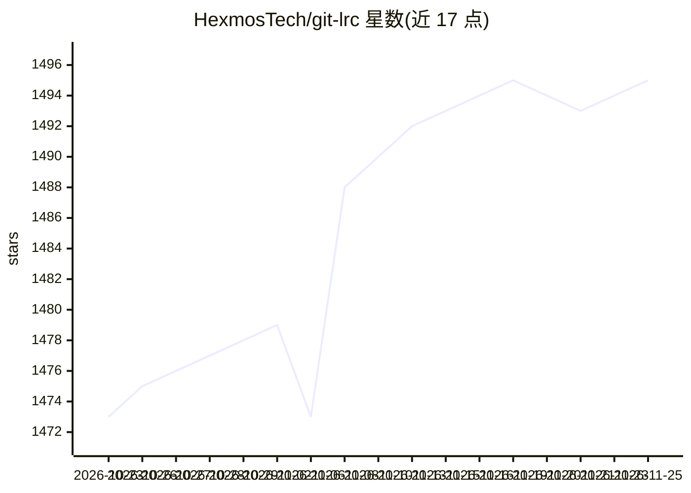

# HexmosTech/git-lrc

⭐ 1,495 · Go · NOASSERTION · 推送 2026-11-22 · [GitHub](https://github.com/HexmosTech/git-lrc) · [官网](https://hexmos.com/livereview/git-lrc/) · 组织维护

**开发者的 git commit 时自动 AI 代码审查工具**

git-lrc 是一个在 git commit 时触发的 AI 代码审查工具：通过 git hook 在每次提交前对暂存 diff 运行 AI 审查，覆盖 10 个风险类别与 100+ 失败模式，提供浏览器审查 UI、严重度过滤的 Issue Navigator、按影响范围排序的风险评分视图，以及自动生成的摘要幻灯片。附带 claude-lrc，在 Claude Code 内提供 review/vouch/skip 斜杠命令；支持 --agent-mode 以 JSON 输出供编码 agent 与 CI 使用。按 LOC 计费，免费档每月 30k LOC。

## 筛选速览

| 维度 | 判定 | 备注 |
|---|---|---|
| AI 角色 | `ai-native` | 本体是模型或模型工具 |
| 许可风险 | `none` | NOASSERTION |
| 部署形态 | `None` |  |
| 模型依赖 | — | README 未给出锁定关系 |
| 硬件要求 | — | 无带数字的原话,不猜 |
| 安装摩擦 | `low` | 无编译、无系统依赖或容器化 |
| 成熟度 | — | 结构信号不足 |

## 能力要点

- commit 时自动触发 AI 审查，全局 hook 一次设置覆盖所有仓库
- Issue Navigator 按严重度/风险类别/类型过滤审查结果
- Agent Mode 非交互输出 JSON，记录 agent-reviewed/vouched/skipped attestation
- 迭代与覆盖率追踪：记录 AI 审查迭代次数与 diff 覆盖百分比

## 适用场景

- AI 生成的代码在提交前被自动审查，拦截泄露的凭据与高危云调用
- 通过审查循环把问题清单回喂给编码 agent 迭代修复
- 团队在 commit 环节统一执行代码审查，不依赖 IDE 或特定 AI 助手
- 用摘要幻灯片与 git log 覆盖历史做新人上手与事后复盘

## 场景标签

`代码审查` `编码 Agent` · 领域:编码与开发

## 证据(README 行号)

> L18: **`git-lrc` is your braking system.** It hooks into `git commit` and runs an AI review on every diff _before_ it la
> L22: **At a glance:** 10 risk categories &middot; 100+ failure patterns tracked &middot; every commit scanned automatica

## 星数曲线

2026-10-23 1,473 → 2026-11-25 1,495（+22）

---
*卡片 v1 · prompt 1.4 · 生成 2026-11-23 · 置信度 high · 依据 README sha `e58f771198a9` · [字段定义](../../DATASET.md)*
