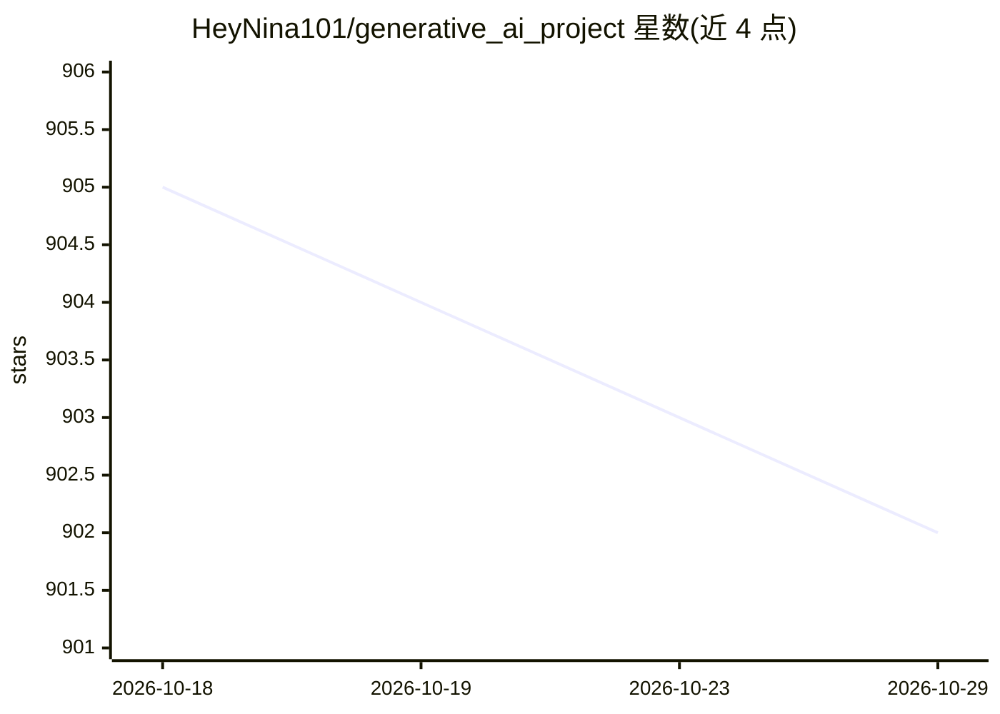

# HeyNina101/generative_ai_project

⭐ 902 · Apache-2.0 · 推送 2026-02-27 · [GitHub](https://github.com/HeyNina101/generative_ai_project) · [官网](https://www.linkedin.com/in/ninadurann/) · 个人维护

**生成式 AI 项目起步模板：提供结构与配置组织方式**

面向生成式 AI 项目早期开发的项目模板仓库：包含 config/（YAML 模型、提示词、日志配置）、data/（提示词、嵌入等动态内容）等目录结构，附带 requirements.txt 依赖文件、README 与 Dockerfile。README 列出提示词版本追踪、YAML 配置分离、响应缓存、速率限制监控等实践建议，入门流程为克隆仓库、安装依赖、配置模型后在 notebook 中开发。仓库本身不含模型实现或运行逻辑，仅提供脚手架。

## 筛选速览

| 维度 | 判定 | 备注 |
|---|---|---|
| AI 角色 | `ai-ecosystem` | LLM/agent 周边工具 |
| 许可风险 | `permissive` | Apache-2.0 |
| 部署形态 | `self-host` | docker 或自建部署 |
| 模型依赖 | — | README 未给出锁定关系 |
| 硬件要求 | — | 无带数字的原话,不猜 |
| 安装摩擦 | `low` | 无编译、无系统依赖或容器化 |
| 成熟度 | — | 结构信号不足 |

## 能力要点

- YAML 配置组织模型、提示词与日志
- config/data 等模块化目录结构
- 附 Dockerfile 容器构建说明

## 适用场景

- 生成式 AI 项目需要统一目录与配置结构时用作起点
- 团队希望按模板实践提示词版本追踪与响应缓存

## 场景标签

 · 领域:生成式 AI/项目脚手架

## 证据(README 行号)

> L3: A production-ready template to help you kickstart and organize your Generative AI projects with clarity and scalabil
> L18: 📁 config/ → YAML config for models, prompts, logging

## 星数曲线

2026-10-18 905 → 2026-10-29 902（-3）

---
*卡片 v1 · prompt 1.4 · 生成 2026-10-21 · 置信度 low · 依据 README sha `5a4827a0e452` · [字段定义](../../DATASET.md)*
