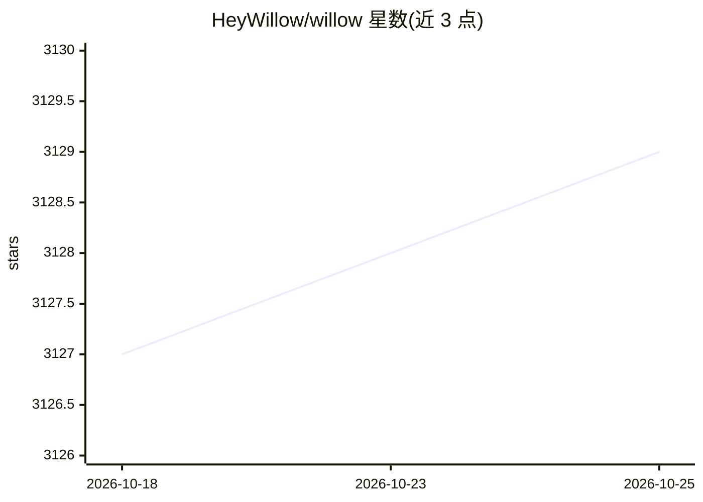

# HeyWillow/willow

⭐ 3,129 · C · Apache-2.0 · 推送 2026-10-01 · [GitHub](https://github.com/HeyWillow/willow) · [官网](https://heywillow.org/) · 组织维护

**开源自托管的本地语音助手，Amazon Echo/Google Home 替代**

基于 ESP32 硬件的开源语音助手项目，定位为 Amazon Echo / Google Home 的替代方案，强调本地运行与自托管及隐私。配套 Willow Inference Server 可自行托管，为 Willow 及其他应用（含 WebRTC）提供 STT、TTS、LLM 等推理任务。项目还处于早期使用者阶段，作者通过 GitHub Discussions/issues 收集反馈；文档位于 heywillow.io。README 未给出安装命令与依赖细节。

## 筛选速览

| 维度 | 判定 | 备注 |
|---|---|---|
| AI 角色 | `ai-native` | 本体是模型或模型工具 |
| 许可风险 | `permissive` | Apache-2.0 |
| 部署形态 | `None` |  |
| 模型依赖 | — | README 未给出锁定关系 |
| 硬件要求 | — | 无带数字的原话,不猜 |
| 安装摩擦 | `low` | 无编译、无系统依赖或容器化 |
| 成熟度 | `idea` | |

## 能力要点

- 基于 ESP32 的开源本地语音助手
- 可自托管 Willow Inference Server，支持 STT/TTS/LLM 推理
- 推理服务器可服务 Willow 之外的其他应用（含 WebRTC）

## 适用场景

- 搭建不依赖云服务的本地语音助手
- 自托管 STT/TTS/LLM 推理服务器供多应用使用

## 场景标签

`语音 Agent` `推理引擎` · 领域:对话与助手

## 证据(README 行号)

> L3: Willow users can now self-host the Willow Inference Server for lightning-fast language inference tasks with Willow a
> L7: Many users across various forums, social media, etc are starting to receive their hardware! I have enabled Github di

## 星数曲线

2026-10-18 3,127 → 2026-10-25 3,129（+2）

---
*卡片 v1 · prompt 1.4 · 生成 2026-10-20 · 置信度 low · 依据 README sha `002ee65a7568` · [字段定义](../../DATASET.md)*
