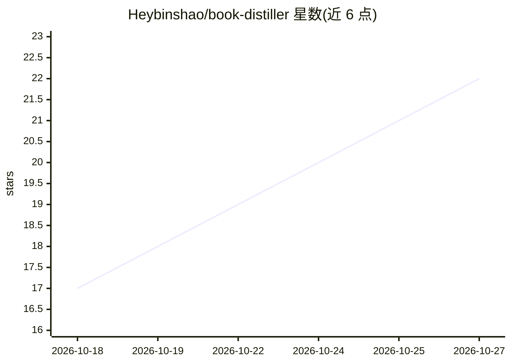

# Heybinshao/book-distiller

⭐ 22 · Python · MIT · 推送 2026-10-03 · [GitHub](https://github.com/Heybinshao/book-distiller) · 个人维护 · 中文 README

**面向非技术用户的 AI 拆书 Skill：epub/pdf/md 拆成结构化知识**

一个以 SKILL.md 形式交付给 AI 编程助手的拆书技能：用户对 AI 说一句话，即完成 epub/pdf/md 的命名规范化、格式转换（依赖 pandoc）、筛选四查（书名校验/MD5 去重/非文字书拦截/覆盖检查）、5 并行拆解、质量检查与五类归档，输出含核心命题、概念四段式、金句、反模式、行动清单的标准拆解文档；另提供原料包架构把几百本拆解整合成主题知识手册。要求 100% 通读全文，token 消耗高于摘要类工具。适用于 macOS 与 Windows，需 pandoc 与 Python 3，可选 opencc/calibre。

## 筛选速览

| 维度 | 判定 | 备注 |
|---|---|---|
| AI 角色 | `ai-native` | 本体是模型或模型工具 |
| 许可风险 | `permissive` | MIT |
| 部署形态 | `None` |  |
| 模型依赖 | — | README 未给出锁定关系 |
| 硬件要求 | — | 无带数字的原话,不猜 |
| 安装摩擦 | `low` | 无编译、无系统依赖或容器化 |
| 成熟度 | — | 结构信号不足 |

## 能力要点

- 筛选四查 + 五类归档 + 断点续跑的批量拆解流水线
- 拆解文档含核心命题/概念四段式/金句/反模式/批判性审视/行动清单
- 原料包架构（约为原文 1/4）支持几百本拆解整合为主题知识手册
- 5 个 Python 成品脚本：原料抽取/索引生成/章节验收/合并/书名提取

## 适用场景

- 我把工具书和方法论书籍丢给 AI，得到可检索的结构化拆解
- 我批量拆解整个文件夹的书并整合成主题知识手册
- 我精读前先看拆解文档，决定是否深挖原书

## 场景标签

`知识库管理` `文档解析` · 领域:知识与检索

## 证据(README 行号)

> L21: 一个 AI 拆书 Skill。你提供文件，它自动完成：
> L24: epub/pdf/md → 命名规范化 → 格式转换 → 筛选四查 → 并行拆解 → 质量检查 → 五类归档 → 结果报告

## 星数曲线

2026-10-18 17 → 2026-10-27 22（+5）

---
*卡片 v1 · prompt 1.4 · 生成 2026-10-27 · 置信度 high · 依据 README sha `0567ace3682f` · [字段定义](../../DATASET.md)*
