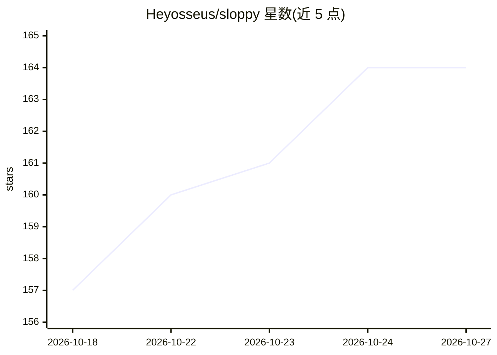

# Heyosseus/sloppy

⭐ 164 · PHP · MIT · 推送 2026-10-26 · [GitHub](https://github.com/Heyosseus/sloppy) · 个人维护

**面向 AI 代理产出代码的 PHP 静态分析工具**

PHP 静态分析器，检测 AI 代理生成代码中的维护性问题：33 条规则覆盖复杂度（God Method）、吞异常、N+1 查询、Laravel 专属模式等，另有变更对比与自描述架构检查。通过 Claude Code/Gemini CLI/Codex 钩子在每次编辑后运行并将发现交回模型修复，提供 MCP server、Pest 插件、CI 标注（GitHub Action、GitLab、SARIF）与 Rector+Pint 自动修复。确定性本地运行，无需模型或 API key，需 PHP 8.3+。

## 筛选速览

| 维度 | 判定 | 备注 |
|---|---|---|
| AI 角色 | `ai-ecosystem` | LLM/agent 周边工具 |
| 许可风险 | `permissive` | MIT |
| 部署形态 | `None` |  |
| 模型依赖 | — | README 未给出锁定关系 |
| 硬件要求 | — | 无带数字的原话,不猜 |
| 安装摩擦 | `low` | 无编译、无系统依赖或容器化 |
| 成熟度 | — | 结构信号不足 |

## 能力要点

- 33 条规则 + 变更对比 + 自定义架构检查（分层违规等）
- Claude Code / Gemini CLI / Codex 编辑后钩子与任务完成门禁，另有 MCP server
- sloppy diff / ci / baseline / fix（经 Rector 与 Pint）与 Pest 插件
- 确定性本地运行：无模型、无 API key、无网络

## 适用场景

- AI 代理每次编辑 PHP 文件后自动检查并让其修复新引入的问题
- 在 CI 中只对本分支引入的新问题拦截门禁
- 在已有历史债务的代码库上做基线后逐步治理

## 场景标签

 · 领域:代码质量/静态分析（PHP）

## 证据(README 行号)

> L26: vendor/bin/sloppy agents install    # make Claude Code check its own work (--host=gemini, --host=codex)
> L64: There's also an MCP server for agents that should
> L6:  Deterministic and local: no model, no API key, no network.

## 星数曲线

2026-10-18 157 → 2026-10-27 164（+7）

---
*卡片 v1 · prompt 1.4 · 生成 2026-10-22 · 置信度 high · 依据 README sha `dd5114464a25` · [字段定义](../../DATASET.md)*
