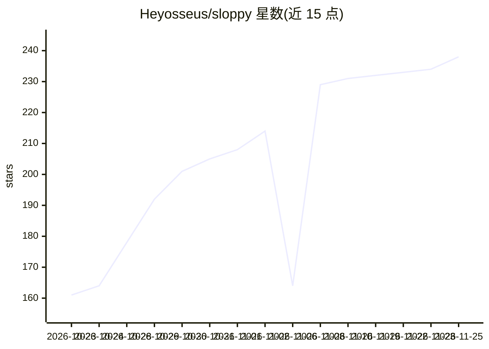

# Heyosseus/sloppy

⭐ 238 · PHP · MIT · 推送 2026-11-19 · [GitHub](https://github.com/Heyosseus/sloppy) · 个人维护

**检查 AI agent 留下 PHP 技术债务的静态分析器：34 条规则、确定性本地运行**

面向 PHP/Laravel 项目的静态分析工具，捕获 god method、吞异常、N+1 查询等 34 条规则命中的模式，并支持通过 Claude Code/Gemini CLI/Codex hooks 在 agent 每次编辑后自动扫描，将新增发现交回模型修复，任务完成检查可在发现超阈值时阻止收尾。无配置文件、无 API key、无网络，完全确定性本地运行；提供 git-diff 审查、baseline 接纳存量债务、CI 注释、Pest 插件、Rector/Pint 修复通道、MCP server 与自定义规则。要求 PHP 8.3+。

## 筛选速览

| 维度 | 判定 | 备注 |
|---|---|---|
| AI 角色 | `ai-enhanced` | 去掉 AI 部分产品仍成立 |
| 许可风险 | `permissive` | MIT |
| 部署形态 | `None` |  |
| 模型依赖 | — | README 未给出锁定关系 |
| 硬件要求 | — | 无带数字的原话,不猜 |
| 安装摩擦 | `low` | 无编译、无系统依赖或容器化 |
| 成熟度 | — | 结构信号不足 |

## 能力要点

- 34 条规则加 3 条 diff 比对检查与 5 条自定义架构规则
- Claude Code hooks：每次编辑后扫描并阻止带新发现的收尾
- 确定性本地运行：无模型、无 API key、无网络
- baseline 按 class/member 键控，diff 模式只报本次引入的发现

## 适用场景

- 让 AI agent 写 PHP 后自动清理它引入的坏模式
- 在 CI 中拦截分支新引入的技术债务并注释到 PR
- 接入存量 Laravel 代码库时用 baseline 只盯新增问题
- 通过 Pest 断言或 PHPStan 集成在现有工具链中拦截新债务

## 场景标签

 · 领域:开发者工具/代码质量

## 证据(README 行号)

> L6:  Deterministic and local: no model, no API key, no network.
> L26: vendor/bin/sloppy agents install    # make Claude Code check its own work (--host=gemini, --host=codex)
> L31: Eloquent-aware rules when it finds Laravel 12 or 13.

## 星数曲线

2026-10-23 161 → 2026-11-25 238（+77）

---
*卡片 v1 · prompt 1.4 · 生成 2026-11-25 · 置信度 high · 依据 README sha `81d0f90ecb87` · [字段定义](../../DATASET.md)*
