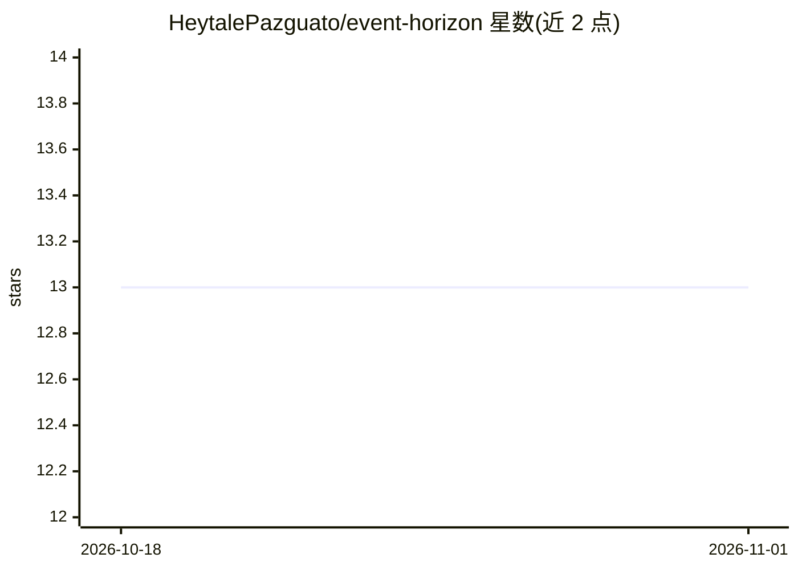

# HeytalePazguato/event-horizon

⭐ 13 · TypeScript · MIT · 推送 2026-10-29 · [GitHub](https://github.com/HeytalePazguato/event-horizon) · [官网](https://heytalepazguato.github.io/event-horizon/) · 个人维护

**VS Code 扩展：将多个 AI 编码代理编排为一个协作团队**

以 VS Code 扩展形式提供的多 AI 编码代理编排工具：一条命令生成计划后，创建计划的代理自动成为编排者，可在可见终端中派生工人代理、分配角色、执行文件锁、进行 Git worktree 隔离、跟踪预算并在失败时按模型升级重试（haiku→sonnet→opus）。兼容 Claude Code、OpenCode、GitHub Copilot、Cursor，可混用。附带宇宙可视化（代理为行星）与运营仪表盘。本地运行于 127.0.0.1:28765，无遥测。

## 筛选速览

| 维度 | 判定 | 备注 |
|---|---|---|
| AI 角色 | `ai-ecosystem` | LLM/agent 周边工具 |
| 许可风险 | `permissive` | MIT |
| 部署形态 | `library` | 以包/库形式分发 |
| 模型依赖 | — | README 未给出锁定关系 |
| 硬件要求 | — | 无带数字的原话,不猜 |
| 安装摩擦 | `low` | 无编译、无系统依赖或容器化 |
| 成熟度 | — | 结构信号不足 |

## 能力要点

- 计划创建者自动成为编排者，可在可见终端派生并管理代理团队
- 文件锁、Git worktree 隔离、原子任务认领与依赖解析
- 按计划预算控制与分层模型选择（先试最便宜模型）
- 52 个 MCP 工具与 8 个内置代理角色，MCP 服务自动注册

## 适用场景

- 同时运行多个 AI 编码代理时协调分工、文件冲突与失败重试
- 通过可视化界面实时观察代理团队的工作进度
- 为多代理协作设置预算上限与成本洞察

## 场景标签

`编码 Agent` `多智能体` · 领域:Agent 开发

## 证据(README 行号)

> L10: **Turn any AI coding agent into a project manager.** One command creates a plan, spawns a team of AI agents, assign
> L46: Your agent becomes the **orchestrator**. It analyzes the work, breaks it into parallel tasks with dependencies, spa
> L79: **Multi-agent orchestration** -- The agent that creates a plan auto-becomes the orchestrator with elevated MCP tool

## 星数曲线

2026-10-18 13 → 2026-11-01 13（+0）

---
*卡片 v1 · prompt 1.4 · 生成 2026-10-31 · 置信度 high · 依据 README sha `85b9e5334cd0` · [字段定义](../../DATASET.md)*
