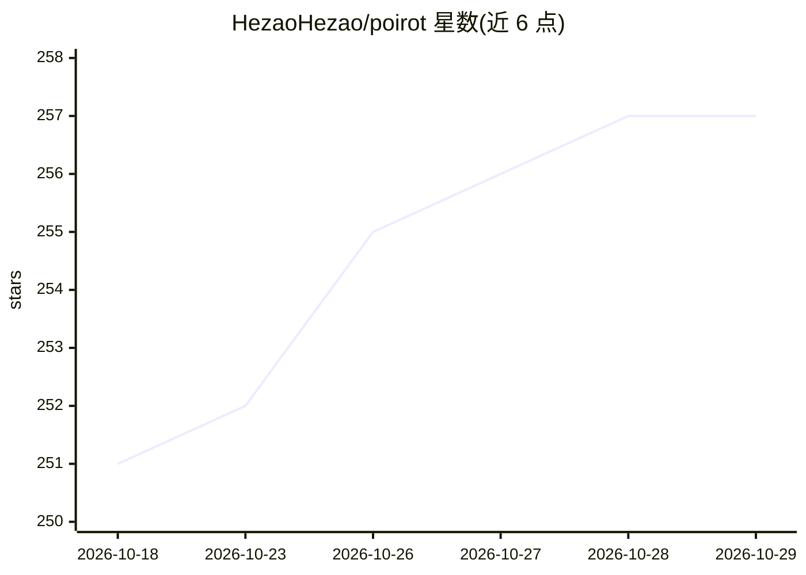

# HezaoHezao/poirot

⭐ 257 · Python · MIT · 推送 2026-07-28 · [GitHub](https://github.com/HezaoHezao/poirot) · 个人维护 · 中文 README

**面向架构研究者的深度研究 Agent 内核，含五层长期记忆**

用 Python 实现的深度研究 Agent 内核：以单一 LeaderAgent 驱动 ReAct 循环，LangGraph 负责外层流程编排，21 个中间件横切各生命周期钩子。内含五层长期记忆（Ebbinghaus 衰减、BM25 检索、非阻塞自动固化）、上下文工程治理（按真实模型窗口动态外置历史）、多 Agent 委派（外部专家 CLI 与自我副本共享 Docker 沙箱）、三层技能自进化架构与双 UI（TUI/CLI）。README 声明 2400+ 测试覆盖各层。需 Python 3.12+，通过源码克隆安装。

## 筛选速览

| 维度 | 判定 | 备注 |
|---|---|---|
| AI 角色 | `ai-ecosystem` | LLM/agent 周边工具 |
| 许可风险 | `permissive` | MIT |
| 部署形态 | `None` |  |
| 模型依赖 | locked-api |  |
| 硬件要求 | — | 无带数字的原话,不猜 |
| 安装摩擦 | `low` | 无编译、无系统依赖或容器化 |
| 成熟度 | — | 结构信号不足 |

## 能力要点

- 五层长期记忆系统：MemoryTrace 协议、Ebbinghaus 衰减、BM25 混合检索、非阻塞自动固化
- 上下文治理按运行时真实模型窗口动态外置/压缩历史消息
- 多 Agent 编排：专家委派与子 Agent 共享线程沙箱，路径写白名单强制持久化
- 36 个内置技能按 5 类组织，技能随有效率下降自动进化

## 适用场景

- 作为深度研究 Agent 的架构参考内核学习 ReAct 循环与中间件设计
- 在沙箱隔离环境中执行多步研究任务并长期沉淀记忆
- 需要可评测、模块独立验证的 Agent 基座做二次开发

## 场景标签

`Agent 框架` `Agent 记忆` `多智能体` `科研工具` · 领域:Agent 开发

## 证据(README 行号)

> L18: Poirot is a deep research agent kernel built for those who care about **how** agents are architected. Rather than c
> L104:  Outer flow: `prepare → before_agent → LeaderAgent (ReAct loop) → after_agent → finalize`. 21 middleware cross-cut

## 星数曲线

2026-10-18 251 → 2026-10-29 257（+6）

---
*卡片 v1 · prompt 1.4 · 生成 2026-10-22 · 置信度 high · 依据 README sha `d9ecb4c54567` · [字段定义](../../DATASET.md)*
