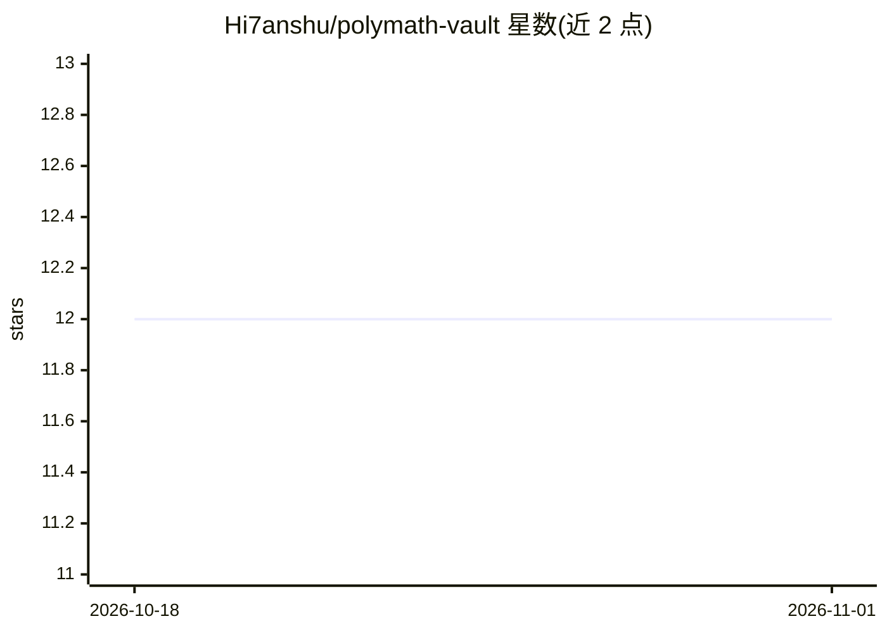

# Hi7anshu/polymath-vault

⭐ 12 · JavaScript · 推送 2026-04-26 · [GitHub](https://github.com/Hi7anshu/polymath-vault) · [官网](https://www.npmjs.com/package/polymath-world) · 个人维护

**一条 npx 命令搭建 Claude 驱动的第二大脑知识库**

面向多兴趣者的第二大脑脚手架工具：npx polymath-world 一条命令生成 PARA 四层文件夹结构、CLAUDE.md 运行模式、技能文件与日常工作流，在 Obsidian 中打开、由 Claude Code 扮演 wiki 维护者——读取来源、分类、提取要点、生成结构化页面、交叉引用并更新索引。集成 Caveman 技能压缩对话输出 token（自称典型 ingest 会话从 4,000 降至约 1,200）。依赖 Obsidian、Node.js 18+ 与 Claude Code。

## 筛选速览

| 维度 | 判定 | 备注 |
|---|---|---|
| AI 角色 | `ai-ecosystem` | LLM/agent 周边工具 |
| 许可风险 | `none` | — |
| 部署形态 | `library` | 以包/库形式分发 |
| 模型依赖 | locked-api |  |
| 硬件要求 | — | 无带数字的原话,不猜 |
| 安装摩擦 | `low` | 无编译、无系统依赖或容器化 |
| 成熟度 | — | 结构信号不足 |

## 能力要点

- npx 一条命令 60 秒内生成完整 vault 结构
- Claude 作为持续维护者：分类、写页、交叉引用、更新索引
- Caveman 技能压缩对话输出 token（vault 文件不受影响）
- 支持 lint 检查：孤立页面、悬空链接、过期综述等

## 适用场景

- 把我散落的文章、PDF、笔记变成有结构、可查询的 wiki
- 用自然语言向自己的知识库提问并获得带引用的回答
- 让 AI 代做第二大脑的日常维护，我只负责思考

## 场景标签

`知识库管理` `文档问答` · 领域:知识与检索

## 证据(README 行号)

> L3: > A structured second brain for people with too many interests — powered by Claude, built on PARA, inspired by Karpa
> L9: One command scaffolds your entire knowledge system: folder structure, Claude schema, skill files, and daily workflow
> L38: That's exactly what `CLAUDE.md` does here. Claude doesn't answer questions and forget. Claude maintains the wiki.

## 星数曲线

2026-10-18 12 → 2026-11-01 12（+0）

---
*卡片 v1 · prompt 1.4 · 生成 2026-11-01 · 置信度 high · 依据 README sha `e5b604c86d0b` · [字段定义](../../DATASET.md)*
