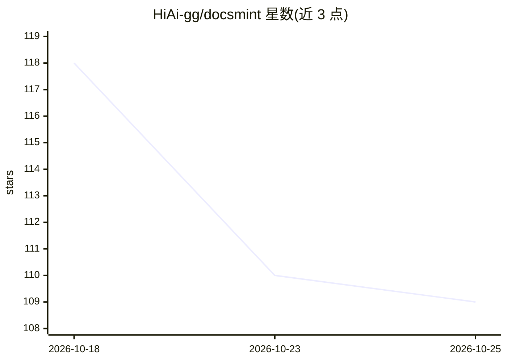

# HiAi-gg/docsmint

⭐ 109 · TypeScript · Apache-2.0 · 推送 2026-10-23 · [GitHub](https://github.com/HiAi-gg/docsmint) · [官网](https://docsmint.com) · 组织维护

**面向人与 AI agent 的自托管知识库：富文本编辑+混合搜索+MCP**

开源文档工作区（Apache-2.0）：用可视化编辑器或 Markdown 编写笔记与文档，按文件夹、分类、标签组织。搜索融合关键词、语义向量、容错匹配与 Apache AGE 图关系，GraphRAG 在常规检索路径中抽取实体并扩展关联文档，跨编码器重排（默认 Voyage rerank-2.5）。文档保存后后台自动切块、嵌入并刷新索引。对外提供 MCP（22 工具）、REST、TypeScript SDK 与 CLI；可用 DocsMint Cloud 托管或 Docker 自托管（PostgreSQL+Redis+SeaweedFS），AI 供应商可选 OpenRouter 或本地 Ollama。

## 筛选速览

| 维度 | 判定 | 备注 |
|---|---|---|
| AI 角色 | `ai-native` | 本体是模型或模型工具 |
| 许可风险 | `permissive` | Apache-2.0 |
| 部署形态 | `self-host` | docker 或自建部署 |
| 模型依赖 | local-ok | 支持本地模型 |
| 硬件要求 | — | 无带数字的原话,不猜 |
| 安装摩擦 | `low` | 无编译、无系统依赖或容器化 |
| 成熟度 | — | 结构信号不足 |

## 能力要点

- 混合搜索：词法+语义+容错+图邻居经 RRF 融合并重排，GraphRAG 在常规路径中运行
- MCP 暴露 22 个工具、2 个提示与 3 个资源，另有 REST/SDK/CLI
- 分类级 API key 显式 read/edit/write 权限
- 文档编辑后后台自动切块、嵌入并原子激活新索引

## 适用场景

- 团队或个人搭建可被 AI agent 检索的知识库
- 通过 MCP 让编码/研究 agent 读取和更新同一文档源
- 需要跨语言、容错与语义检索的笔记与项目文档管理

## 场景标签

`知识库管理` · 领域:知识与检索

## 证据(README 行号)

> L3: **Turn your documents into knowledge you and your AI agents can use.**
> L72: - **Find the document you mean.** Search combines keywords, meaning, typo
> L330: GraphRAG is part of the normal search path in the reference configuration. It

## 星数曲线

2026-10-18 118 → 2026-10-25 109（-9）

---
*卡片 v1 · prompt 1.4 · 生成 2026-10-23 · 置信度 mid · 依据 README sha `102fba455580` · [字段定义](../../DATASET.md)*
