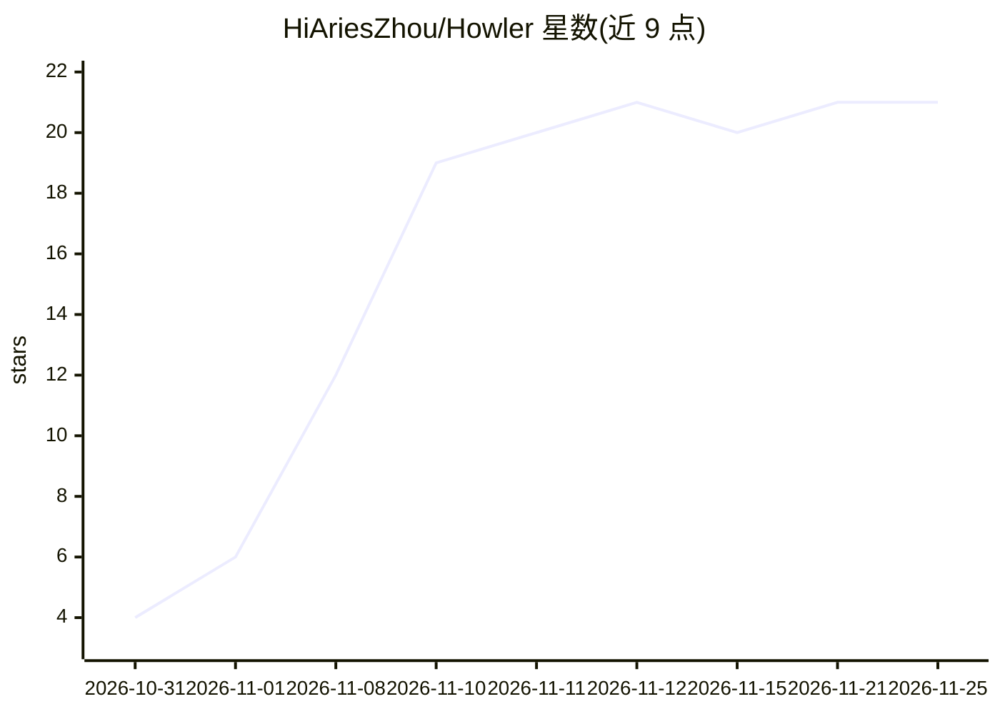

# HiAriesZhou/Howler

⭐ 21 · Swift · MIT · 推送 2026-11-22 · [GitHub](https://github.com/HiAriesZhou/Howler) · [官网](https://howler.arieszhou.com) · 个人维护 · 中文 README

**macOS 菜单栏阅后即焚式 AI 问答信件应用**

面向 macOS 用户的菜单栏 AI 问答应用：按 ⌥H 呼出仿真信纸，输入问题后以流式羽毛笔效果书写模型回答，按 Esc 或点击火焰图标销毁对话，不留聊天历史。支持 OpenAI/Anthropic/Gemini/xAI/DeepSeek/OpenRouter 预设及兼容端点（含本地 Ollama/LM Studio），API key 存入 macOS Keychain；支持粘贴长文本/图片与屏幕区域截图提问。要求 macOS 14+，Swift 5.10，唯一第三方依赖为 Sparkle。限制：模型不能联网搜索，回答仅基于训练数据。

## 筛选速览

| 维度 | 判定 | 备注 |
|---|---|---|
| AI 角色 | `ai-native` | 本体是模型或模型工具 |
| 许可风险 | `permissive` | MIT |
| 部署形态 | `desktop` | 安装包/桌面程序 |
| 模型依赖 | local-ok | 支持本地模型 |
| 硬件要求 | — | 无带数字的原话,不猜 |
| 安装摩擦 | `low` | 无编译、无系统依赖或容器化 |
| 成熟度 | — | 结构信号不足 |

## 能力要点

- 阅后即焚：Esc 或火焰销毁对话，无聊天历史、无日志、无遥测
- 支持 openai/anthropic/gemini/xai/deepseek/openrouter 预设及兼容端点（含本地 Ollama/LM Studio）
- 粘贴长文本或图片、截取屏幕区域作为附件提问
- API key 存入 macOS Keychain，请求直连所配置服务、不经中转

## 适用场景

- 随时按快捷键向 AI 提问并获取不留痕的回答
- 把截图或剪贴板内容发给模型解释
- 重视隐私、不希望保留聊天记录的日常问答

## 场景标签

`AI 助手` · 领域:对话与助手

## 证据(README 行号)

> L8:  Write on the parchment, a quill writes the answer back, and the letter burns when you're done.
> L26: - **A quill that writes.** Answers stream in at a hand's pace. Fresh ink glows gold before it settles to sepia, and
> L78: |`format`|`chat-completions` (OpenAI and compatible, including local Ollama / LM Studio), `anthropic-messages`, `ge

## 星数曲线

2026-10-31 4 → 2026-11-25 21（+17）

---
*卡片 v1 · prompt 1.4 · 生成 2026-11-18 · 置信度 high · 依据 README sha `776ab7332519` · [字段定义](../../DATASET.md)*
