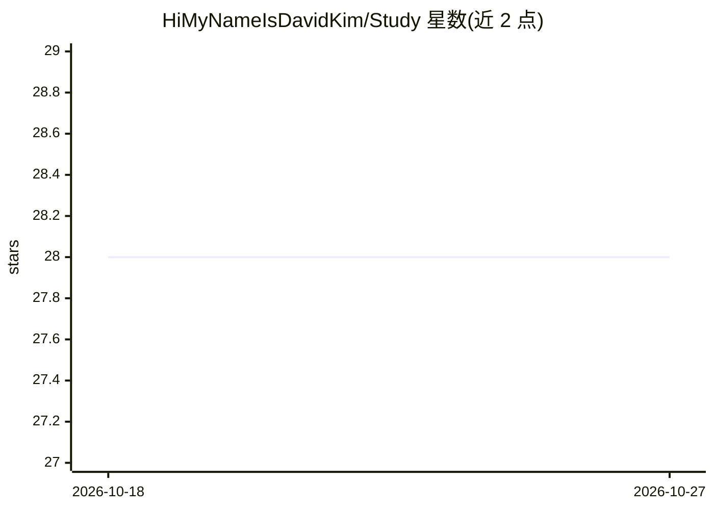

# HiMyNameIsDavidKim/Study

⭐ 28 · Jupyter Notebook · 推送 2026-10-26 · [GitHub](https://github.com/HiMyNameIsDavidKim/Study) · 个人维护

**个人数据科学/AI 学习与论文阅读记录仓库**

由 HiMyNameIsDavidKim 维护的个人学习笔记仓库，内容按基础知识、Python、AI（ML/DL、CV、NLP、RecSys）、数据分析工具、云服务、项目与书籍清单组织。核心是论文阅读清单：覆盖 Transformer/ViT/CNN、自监督学习、LLM、VLM、目标检测、拼图谜题自监督、生成模型与推荐系统等方向，以✅标记已读并附博客/笔记链接；另收录多个项目链接（CV 模型、欺诈检测、TTS 微调等）与已读书单。仓库为静态文档，不含可安装运行的代码。

## 筛选速览

| 维度 | 判定 | 备注 |
|---|---|---|
| AI 角色 | `ai-knowledge` | 知识聚合/清单类 |
| 许可风险 | `none` | — |
| 部署形态 | `None` |  |
| 模型依赖 | — | README 未给出锁定关系 |
| 硬件要求 | — | 无带数字的原话,不猜 |
| 安装摩擦 | `low` | 无编译、无系统依赖或容器化 |
| 成熟度 | — | 结构信号不足 |

## 能力要点

- 覆盖 CV/NLP/RecSys 等方向的论文阅读清单，标记已读状态并附博客与笔记链接
- 收录个人研究项目与 Side Project 的仓库链接
- 含数据分析、ML、算法方向的已读书单（韩文书籍为主）

## 适用场景

- 查阅某研究方向（如自监督、推荐系统）的论文清单与阅读顺序参考
- 了解一名 AI 研究工程师的学习路径与项目实践
- 寻找韩文数据科学/AI 学习书籍的参考

## 场景标签

`精选清单` · 领域:学习与行业

## 证据(README 行号)

> L129: ## 📓 Paper List
> L10: ### 📓 Paper List

## 星数曲线

2026-10-18 28 → 2026-10-27 28（+0）

---
*卡片 v1 · prompt 1.4 · 生成 2026-10-26 · 置信度 high · 依据 README sha `1f1284ed3471` · [字段定义](../../DATASET.md)*
