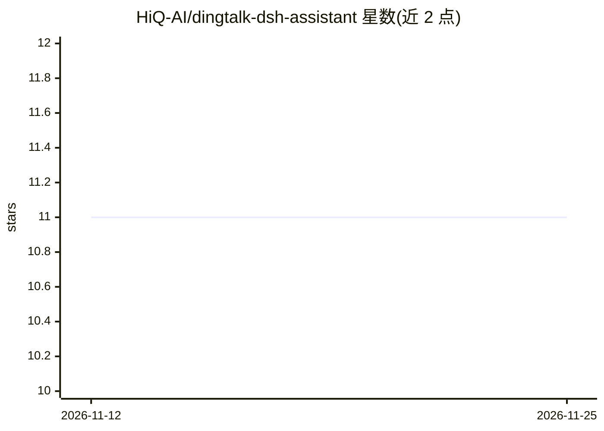

# HiQ-AI/dingtalk-dsh-assistant

⭐ 11 · JavaScript · 推送 2026-11-09 · [GitHub](https://github.com/HiQ-AI/dingtalk-dsh-assistant) · 组织维护 · 中文 README

**把钉钉群聊接入 DeepSeek Harness 的数字员工插件**

TypeScript 编写的 DSH 插件，将钉钉群消息接入 DeepSeek Harness：轻量首筛判断是否处理，常驻 Router 按真实会话身份将来源关联到 Task；每任务一个持久 Owner 会话统筹，执行会话可用 DSH 原生 Session 或交互式 Claude Code CLI 后端完成具体工作，支持版本 CAS、持久账本、通知回执确认与失败精确恢复。README 明确注明真实钉钉收发与生产场景尚未验收，旧独立协调功能已于 2026-10-29 退役。

## 筛选速览

| 维度 | 判定 | 备注 |
|---|---|---|
| AI 角色 | `ai-native` | 本体是模型或模型工具 |
| 许可风险 | `none` | — |
| 部署形态 | `library` | 以包/库形式分发 |
| 模型依赖 | locked-api |  |
| 硬件要求 | — | 无带数字的原话,不猜 |
| 安装摩擦 | `low` | 无编译、无系统依赖或容器化 |
| 成熟度 | `idea` | |

## 能力要点

- 群消息经轻量首筛与常驻 Router 直接路由到 Task
- 执行后端可选 DSH 原生 Session 或 Claude Code CLI（Agent Teams）
- 每轮执行文档、持久账本与按 retryToken 的精确恢复机制
- 首筛/Router/统筹模型及推理深度可分别配置校验

## 适用场景

- 在钉钉群里让 AI 数字员工受理并跟进群内任务
- 多执行会话并行完成委派的业务工作并留存执行文档
- 需要发送回执、失败恢复与审计账本的任务自动化

## 场景标签

`多智能体` `聊天机器人` · 领域:Agent 开发

## 证据(README 行号)

> L1: 钉钉群聊中的 DeepSeek Harness 数字员工
> L15: `dingtalk-dsh-assistant` 把钉钉群聊接入 DeepSeek Harness（DSH）。轻量首筛识别是否需要处理及是否简答；每个已订阅真实群聊由独立常驻 Router 处理后续来源，并直接关联 Task。Ta
> L38: - 每个受托执行有自己的 `executionId`、后端会话、租约和工作目录，后端为 DSH 原生 Session 或 Claude Code CLI。同任务可并行多个执行，同一执行只能单飞；续办保留原后端和会话身份，递增输入版

## 星数曲线

2026-11-12 11 → 2026-11-25 11（+0）

---
*卡片 v1 · prompt 1.4 · 生成 2026-11-19 · 置信度 high · 依据 README sha `91ba8bf65367` · [字段定义](../../DATASET.md)*
