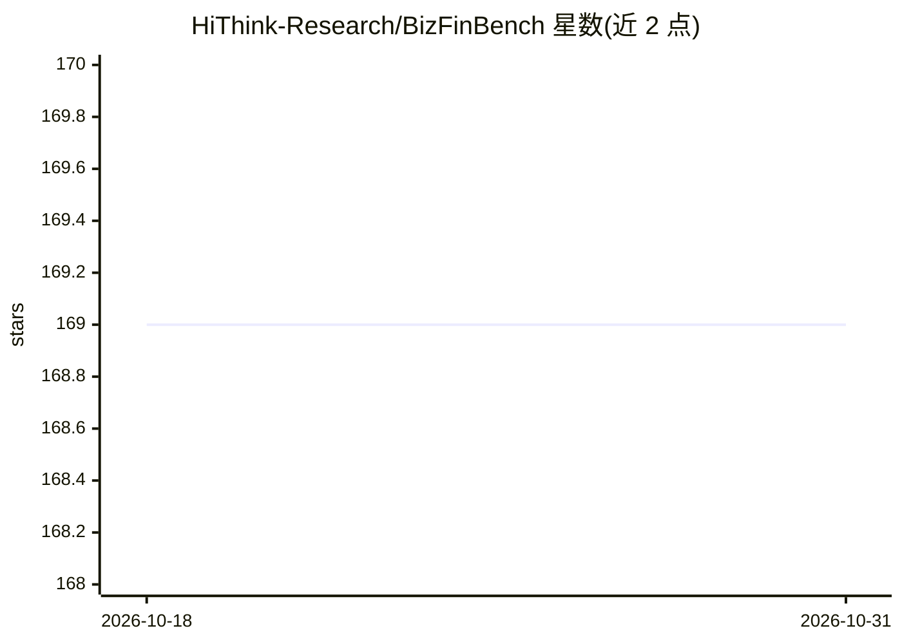

# HiThink-Research/BizFinBench

⭐ 169 · Python · 推送 2026-05-01 · [GitHub](https://github.com/HiThink-Research/BizFinBench) · [官网](https://hithink-research.github.io/BizFinBench/) · 组织维护 · 中文 README

**面向真实金融业务的 LLM 评测基准（10万+中英双语题目）**

由 HiThink Research（同花顺研究团队）发布的金融领域 LLM 评测基准：v2 收录 29,578 条源自真实商业场景的中英双语金融题目（v1 超 10 万条），覆盖异常事件归因、数值计算、时间推理、工具调用、知识问答等 9 个类别、5 个维度。配套 Iterajudge 评审模型方法，支持本地模型（经 vLLM 后端服务）与外部 API（chatgpt）两种评测路径，并提供 25 个 LLM 的评测结果。代码与数据仅限研究用途（CC BY-NC 4.0）。

## 筛选速览

| 维度 | 判定 | 备注 |
|---|---|---|
| AI 角色 | `ai-ecosystem` | LLM/agent 周边工具 |
| 许可风险 | `none` | — |
| 部署形态 | `library` | 以包/库形式分发 |
| 模型依赖 | local-ok | 支持本地模型 |
| 硬件要求 | — | 无带数字的原话,不猜 |
| 安装摩擦 | `low` | 无编译、无系统依赖或容器化 |
| 成熟度 | — | 结构信号不足 |

## 能力要点

- 9 个金融子任务覆盖数值计算、时间推理、工具调用、情绪识别等能力
- Iterajudge 评审模型方法细化金融评测中的判断边界
- 支持本地模型（vLLM 后端）与外部 API 两种评测方式
- 已发布 25 个 LLM 的完整评测结果

## 适用场景

- 评测自研或开源 LLM 在金融业务场景下的表现
- 对比专有模型与开源模型在金融推理任务上的差距
- 金融领域 LLM 选型的数据依据

## 场景标签

`模型评测` `金融量化` · 领域:评测与运维

## 证据(README 行号)

> L12: Large language models excel across general tasks, yet judging their reliability in logic‑heavy, precision‑critical 
> L24: - 🔥 **Benchmark:** We propose **BizFinBench**, the first evaluation benchmark in the financial domain that integrat

## 星数曲线

2026-10-18 169 → 2026-10-31 169（+0）

---
*卡片 v1 · prompt 1.4 · 生成 2026-10-23 · 置信度 high · 依据 README sha `798d8707826f` · [字段定义](../../DATASET.md)*
