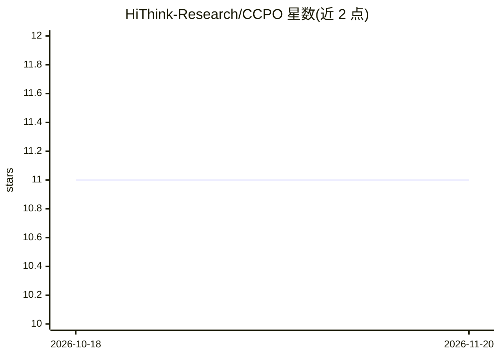

# HiThink-Research/CCPO

⭐ 11 · Python · 推送 2026-08-07 · [GitHub](https://github.com/HiThink-Research/CCPO) · 组织维护

**多轮 GUI Agent 的坐标压缩策略优化训练框架**

论文 Compress to Focus 的官方实现：提出 CCPO 框架，将 Coordinate-Aware Spatial Compression（CASC）与策略优化耦合，聚合多 rollout 的坐标构建注意力边界以压缩多轮交互历史，配合基于距离的 advantage 提供细粒度学习信号。基于 Qwen2.5-VL 先做 SFT 再训练，在 Android Control、GUI Odyssey、Mind2Web、AITW 四个基准上评测，提供 3B/7B 预训练模型与评测脚本。要求 Linux、Python 3.12+、PyTorch 2.7+、CUDA 12.8+。

## 筛选速览

| 维度 | 判定 | 备注 |
|---|---|---|
| AI 角色 | `ai-native` | 本体是模型或模型工具 |
| 许可风险 | `permissive` | — |
| 部署形态 | `None` |  |
| 模型依赖 | — | README 未给出锁定关系 |
| 硬件要求 | — | 无带数字的原话,不猜 |
| 安装摩擦 | `medium` | 含编译或系统依赖之一 |
| 成熟度 | — | 结构信号不足 |

## 能力要点

- CASC 空间压缩实现最高 60% token 压缩
- 基于空间距离的 advantage 提供细粒度训练信号
- 训练相对标准 RL 基线提供 3.5x–4.8x 加速
- 提供 3B/7B 预训练模型与 AITW 评测脚本

## 适用场景

- 复现论文中多轮 GUI Agent 的 RL 训练
- 下载预训练模型在 AITW 基准上评测
- 研究视觉压缩与策略优化结合的训练方法

## 场景标签

`模型训练` `模型评测` `强化学习` · 领域:评测与运维

## 证据(README 行号)

> L19: The official implementation of the paper "Compress to Focus: Efficient Coordinate Compression for Policy Optimizati
> L65: We first perform Supervised Fine-Tuning (SFT) on **Qwen2.5-VL** as the warm-up stage.
> L88: We provide pre-trained models (3B and 7B) for reproduction.

## 星数曲线

2026-10-18 11 → 2026-11-20 11（+0）

---
*卡片 v1 · prompt 1.4 · 生成 2026-11-19 · 置信度 high · 依据 README sha `f2089f61d0c8` · [字段定义](../../DATASET.md)*
