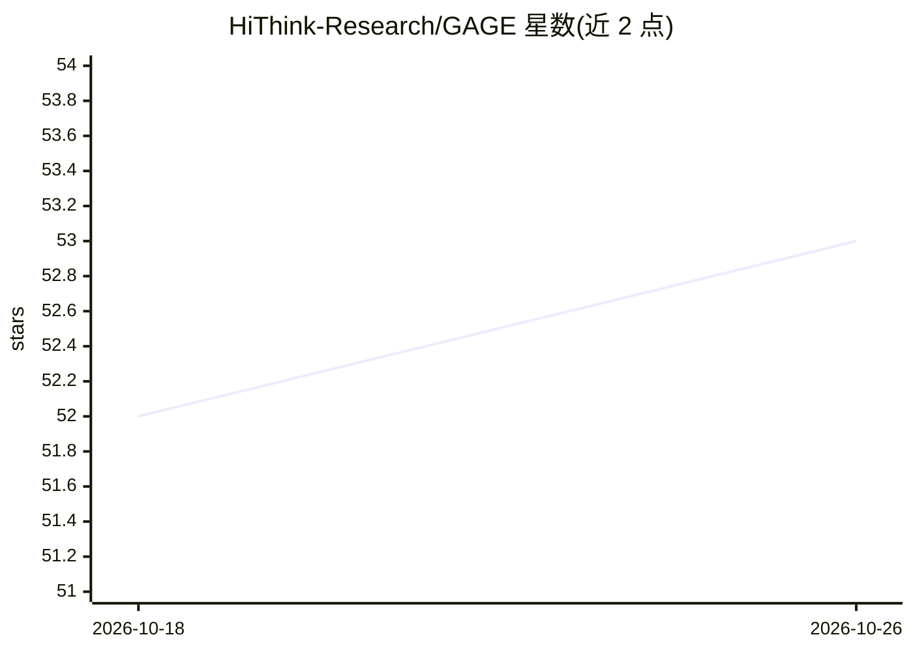

# HiThink-Research/GAGE

⭐ 53 · Python · 推送 2026-06-02 · [GitHub](https://github.com/HiThink-Research/GAGE) · 组织维护 · 中文 README

**统一评测引擎：LLM/多模态/音频/扩散模型与游戏竞技场评测**

GAGE 是面向大语言模型、多模态、音频、扩散模型、agent 与游戏环境的统一可扩展评测框架：数据集、模型后端、角色适配器、指标与输出契约以配置方式接入；内置 Game Arena 运行时（五子棋、斗地主、麻将、Space Invaders、Mario、ViZDoom 等可回放对局轨迹）、AgentKitV2 本地/Docker 化 agent 任务路径，以及把任务批次委托给外部 Harbor harness 再回导证据的机制。运行产物包括 summary.json、样本输出、日志与静态 HTML 报告包。README 声明项目处于内部验证阶段，API 与配置可能快速变化。

## 筛选速览

| 维度 | 判定 | 备注 |
|---|---|---|
| AI 角色 | `ai-ecosystem` | LLM/agent 周边工具 |
| 许可风险 | `none` | — |
| 部署形态 | `None` |  |
| 模型依赖 | — | README 未给出锁定关系 |
| 硬件要求 | — | 无带数字的原话,不猜 |
| 安装摩擦 | `low` | 无编译、无系统依赖或容器化 |
| 成熟度 | — | 结构信号不足 |

## 能力要点

- 同一流水线跑本地冒烟测试、模型任务与大批量基准
- Game Arena 支持人机对局（浏览器操控）与 LLM 玩家，输出可回放轨迹
- AgentKitV2 支持 AppWorld、SWE-bench Pro（Docker）、Tau2 等 agent 任务
- 外部 harness（Harbor）集成：委托批次并回导为标准样本与指标

## 适用场景

- 用同一引擎跑文本/多模态/agent/游戏环境多类基准评测
- 在浏览器里与 LLM 玩斗地主或实时操控 Mario 观察模型行为
- 把 Harbor 外部基准任务结果统一回收到 GAGE 报告体系中

## 场景标签

`模型评测` · 领域:评测与运维

## 证据(README 行号)

> L14: **GAGE** is a unified, extensible evaluation framework for large language models, multimodal models, audio models, 
> L26: - **Fast evaluation engine**: Run local smoke tests, model-backed jobs, and larger benchmark batches through the sa
> L28: - **Game and agent sandboxing**: Game Arena, AgentKitV2, AppWorld, SWE-bench-style agent tasks, GUI interaction, an

## 星数曲线

2026-10-18 52 → 2026-10-26 53（+1）

---
*卡片 v1 · prompt 1.4 · 生成 2026-10-24 · 置信度 high · 依据 README sha `29094ff8d38f` · [字段定义](../../DATASET.md)*
