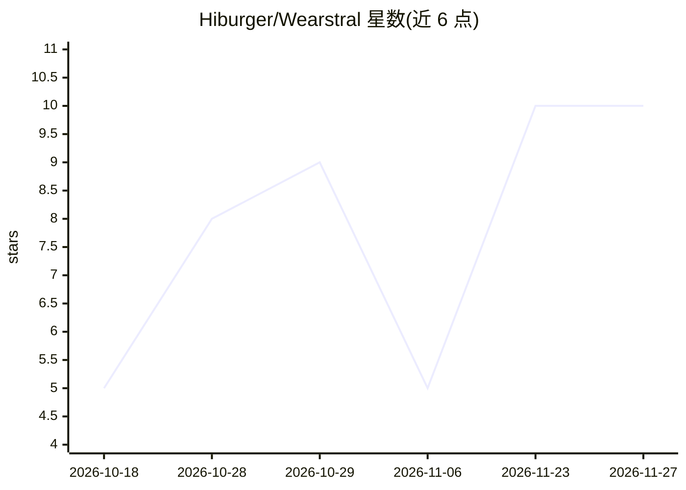

# Hiburger/Wearstral

⭐ 10 · Kotlin · GPL-3.0 · 推送 2026-10-30 · [GitHub](https://github.com/Hiburger/Wearstral) · 个人维护

**Wear OS 手表上直接对话 Mistral AI 的原生客户端**

用 Kotlin 和 Compose 构建的 Wear OS 原生应用，通过用户自建 API key 直连 api.mistral.ai 与 Mistral 模型对话，为圆形小屏设计。支持键盘与本地语音输入（Vosk 离线转写）、持久聊天历史、Markdown 渲染回复、侧边栏快捷操作，API key 加密存储在设备上。非官方 Mistral 项目，不封装网页版；处于早期开发阶段，从源码构建需 Android SDK 与 JDK 17+。

## 筛选速览

| 维度 | 判定 | 备注 |
|---|---|---|
| AI 角色 | `ai-native` | 本体是模型或模型工具 |
| 许可风险 | `viral` | GPL-3.0 |
| 部署形态 | `None` |  |
| 模型依赖 | — | README 未给出锁定关系 |
| 硬件要求 | — | 无带数字的原话,不猜 |
| 安装摩擦 | `medium` | 含编译或系统依赖之一 |
| 成熟度 | `idea` | |

## 能力要点

- 键盘输入与 Vosk 端侧离线语音转写（音频不外发）
- 聊天历史持久化，支持置顶、删除与清空
- API key 设备端加密存储（BYOK 模式）
- 针对圆形表盘的 UI 布局与 Markdown 回复渲染

## 适用场景

- 在手表上随时随地与 Mistral AI 对话
- 将手表应用设为语音助手使用
- 离线环境（无网络时）完成语音转文字输入

## 场景标签

`聊天机器人` · 领域:对话与助手

## 证据(README 行号)

> L5: A native Wear OS client for chatting with Mistral AI models through the Mistral API.
> L26: - **Chat**: conversations with Mistral models, replies rendered with light Markdown (bold, italic,
> L44: Early development, but very very usable! :)

## 星数曲线

2026-10-18 5 → 2026-11-27 10（+5）

---
*卡片 v1 · prompt 1.4 · 生成 2026-11-23 · 置信度 high · 依据 README sha `2a0ecb7dc867` · [字段定义](../../DATASET.md)*
