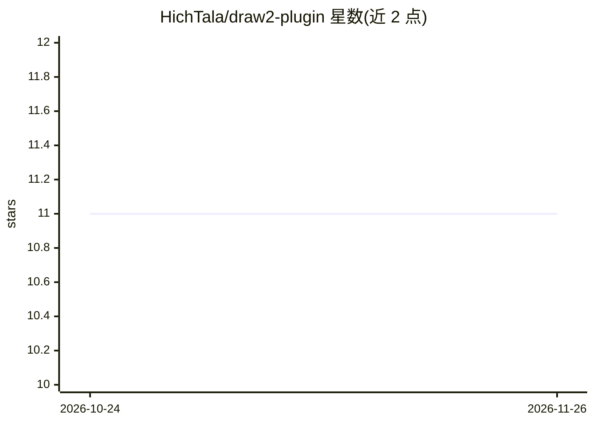

# HichTala/draw2-plugin

⭐ 11 · C++ · AGPL-3.0 · 推送 2026-11-09 · [GitHub](https://github.com/HichTala/draw2-plugin) · 个人维护

**OBS 插件：直播中实时检测并展示游戏王卡牌**

DRAW 2 系统的插件部分，将游戏王卡牌检测器集成进 OBS Studio 的直播流或录制视频。插件作为 Qt dock 与自定义源接入 OBS，在后台启动独立的 Python 进程运行 `draw` 检测后端并通过共享内存通信，实时显示检测到的卡牌。支持最多 3 个卡组文件（.ydk）过滤、双人模式（每玩家独立检测器）、检测区域裁剪、置信度阈值等设置；卡组也可经 HTTP(S) URL 或 YDKE 代码远程加载。Windows/Linux 提供安装包，macOS 构建未发布，可从源码构建。

## 筛选速览

| 维度 | 判定 | 备注 |
|---|---|---|
| AI 角色 | `ai-native` | 本体是模型或模型工具 |
| 许可风险 | `viral` | AGPL-3.0 |
| 部署形态 | `desktop` | 安装包/桌面程序 |
| 模型依赖 | — | README 未给出锁定关系 |
| 硬件要求 | — | 无带数字的原话,不猜 |
| 安装摩擦 | `medium` | 含编译或系统依赖之一 |
| 成熟度 | `idea` | |

## 能力要点

- 实时检测游戏王卡牌并作为 OBS 源叠加显示
- 双人模式为每名玩家运行独立检测器
- 支持 .ydk / HTTP(S) URL / YDKE 多种卡组来源
- 可配置检测区域裁剪、置信度阈值与调试日志

## 适用场景

- 游戏王对战直播时实时向观众展示双方手牌卡面
- 录制对战视频并叠加卡牌识别结果
- 从远程 API 或赛事系统拉取卡组用于直播过滤

## 场景标签

`目标检测` · 领域:感知与多模态

## 证据(README 行号)

> L15: DRAW 2 (which stands for **D**etect and **R**ecognize **A** **W**ide range of cards version 2) is an object detecto
> L18: This project is the plugin part of the DRAW 2 system. It allows users to seamlessly integrate the
> L228: 4. Click the `Start DRAW` button to start the detection process. The plugin will start detecting cards in real tim

## 星数曲线

2026-10-24 11 → 2026-11-26 11（+0）

---
*卡片 v1 · prompt 1.4 · 生成 2026-11-19 · 置信度 mid · 依据 README sha `87f4a582bbb9` · [字段定义](../../DATASET.md)*
