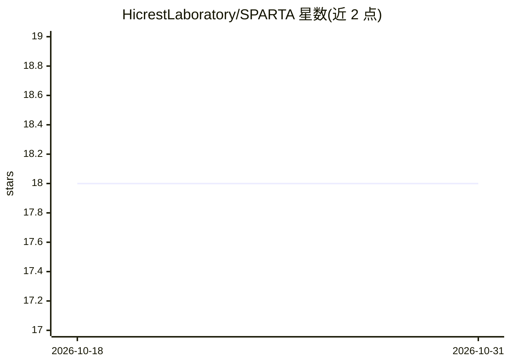

# HicrestLaboratory/SPARTA

⭐ 18 · Emacs Lisp · 推送 2026-04-15 · [GitHub](https://github.com/HicrestLaboratory/SPARTA) · 组织维护

**稀疏矩阵重排分块加速库：面向 GPU 张量架构的压缩与乘法**

面向深度学习与图分析等稀疏不规则应用的 CUDA 库：通过哈希初筛与可调余弦相似度算法，将 CSR/CSC 格式稀疏矩阵中模式相近的行列重排并压缩为变块（VBR）稠密块数据结构；提供基于该结构的稀疏-稠密矩阵乘法，支持 cuBLAS/cuSparse 等多种乘法后端与多种分块算法选项。要求 CUDA >=10.0，通过 make 编译并运行测试程序，输入为边列表格式的矩阵。

## 筛选速览

| 维度 | 判定 | 备注 |
|---|---|---|
| AI 角色 | `ai-ecosystem` | LLM/agent 周边工具 |
| 许可风险 | `none` | — |
| 部署形态 | `None` |  |
| 模型依赖 | — | README 未给出锁定关系 |
| 硬件要求 | — | 无带数字的原话,不猜 |
| 安装摩擦 | `medium` | 含编译或系统依赖之一 |
| 成熟度 | — | 结构信号不足 |

## 能力要点

- 基于哈希+余弦相似度的行列重排与稠密块构建算法
- 变块压缩 VBR 数据结构与稀疏-稠疏矩阵乘法实现
- 6 种分块算法与 4 种乘法后端（cuBLAS GEMM/cuSparse 等）可选
- 提供跨 AI 加速器的抽象层设计目标

## 适用场景

- 图分析与稀疏 DNN/GCN 的矩阵压缩与加速
- 研究稀疏矩阵重排分块算法的效果
- 在 GPU 上执行稀疏-稠密矩阵乘法的基准实验

## 场景标签

 · 领域:高性能计算/稀疏线性代数

## 证据(README 行号)

> L4: The project aims to investigate new data structures and compression algorithms for exploiting new architecture capab
> L15: SPARTA requires CUDA >=10.0

## 星数曲线

2026-10-18 18 → 2026-10-31 18（+0）

---
*卡片 v1 · prompt 1.4 · 生成 2026-10-29 · 置信度 mid · 依据 README sha `7a58397bc175` · [字段定义](../../DATASET.md)*
