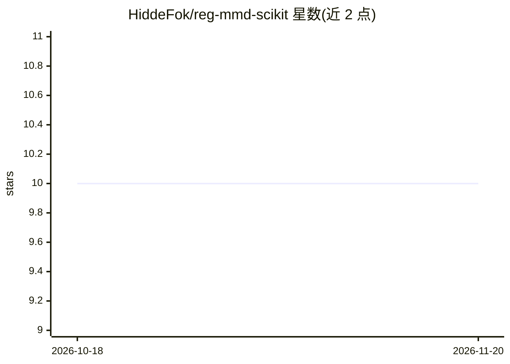

# HiddeFok/reg-mmd-scikit

⭐ 10 · Python · GPL-3.0 · 推送 2026-05-07 · [GitHub](https://github.com/HiddeFok/reg-mmd-scikit) · [官网](https://hiddefok.github.io/reg-mmd-scikit/) · 个人维护

**面向统计用户的 MMD 稳健估计与回归 Python 库**

scikit-learn 兼容的参数化估计与回归实现，基于最大均值差异（MMD）准则：通过最小化经验样本与参数模型在再生核希尔伯特空间中的均值嵌入距离来拟合模型，对离群点、模型误设及任意比例的数据污染具有可证明的一致性。提供 MMDEstimator 与 MMDRegressor 两个 fit/predict 接口估计器，内置约 20 种估计模型与 8 种回归模型，支持三种一维核与中位数启发式带宽；优化器优先解析梯度，缺失时回退 SGD，估计环节另有 Cython 加速循环。方法依据 2024/2022 两篇论文，并从原作者 R 包移植，Python 3.11+ 经 pip/uv 安装。

## 筛选速览

| 维度 | 判定 | 备注 |
|---|---|---|
| AI 角色 | `ai-native` | 本体是模型或模型工具 |
| 许可风险 | `viral` | GPL-3.0 |
| 部署形态 | `library` | 以包/库形式分发 |
| 模型依赖 | — | README 未给出锁定关系 |
| 硬件要求 | — | 无带数字的原话,不猜 |
| 安装摩擦 | `medium` | 含编译或系统依赖之一 |
| 成熟度 | — | 结构信号不足 |

## 能力要点

- 两个 scikit-learn 风格估计器，兼容 Pipeline 与 GridSearchCV
- 19 种估计模型与 8 种回归模型，字符串或类实例选择
- 解析梯度优先、SGD 回退的双路优化器，估计环节提供 Cython 加速
- 三种 1-D 核（Gaussian/Laplace/Cauchy）与中位数启发式带宽

## 适用场景

- 样本含离群点或对抗污染时的参数估计
- 响应变量分布非典型场景下的回归拟合
- 在 scikit-learn Pipeline 中嵌入稳健回归步骤

## 场景标签

 · 领域:机器学习/统计估计

## 证据(README 行号)

> L8: `regmmd` is a scikit-learn-compatible implementation of parametric estimation
> L66: - **`MMDEstimator`** — fits a univariate parametric model to an i.i.d. sample
> L68: - **`MMDRegressor`** — fits a regression model (`fit`/`predict` API,

## 星数曲线

2026-10-18 10 → 2026-11-20 10（+0）

---
*卡片 v1 · prompt 1.4 · 生成 2026-11-20 · 置信度 high · 依据 README sha `725dcdc6d216` · [字段定义](../../DATASET.md)*
