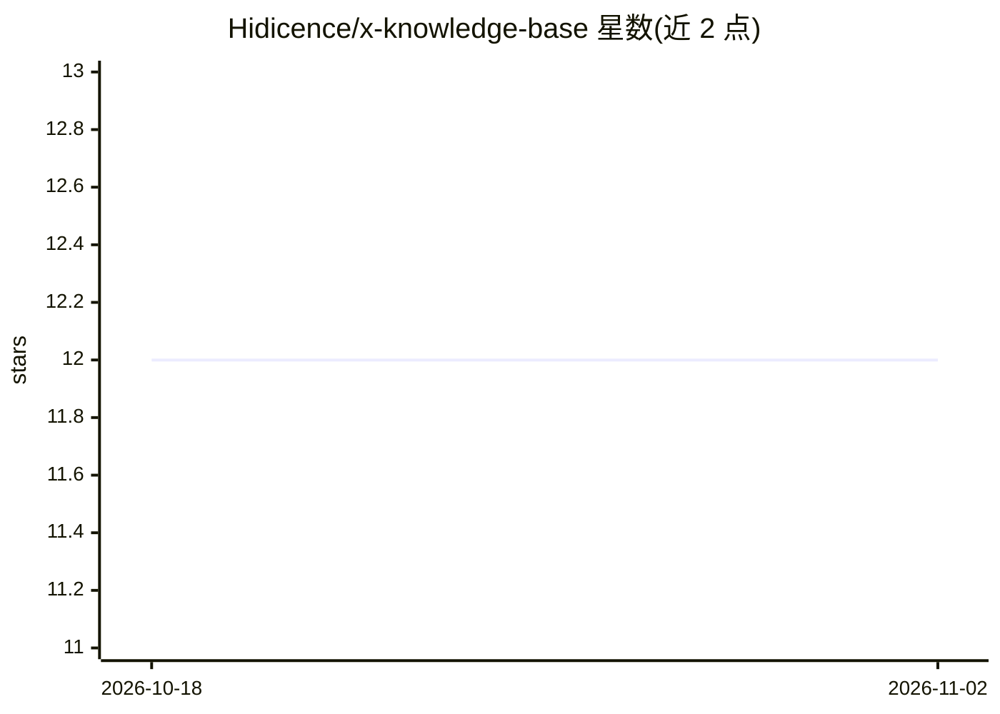

# Hidicence/x-knowledge-base

⭐ 12 · Python · NOASSERTION · 推送 2026-10-07 · [GitHub](https://github.com/Hidicence/x-knowledge-base) · 个人维护 · 中文 README

**自托管 AI agent 记忆库：把卡片、wiki 与历史对话召回进对话**

面向 AI agent 的自托管知识服务：以源链接的 Markdown 卡片、wiki 主题和捕获的对话记录为存储，通过 MCP、HTTP 与 CLI 三类客户端共享同一召回核心，可在用户未提问时由 hook 主动带回最多三条相关证据。召回流程为读取允许来源→检索候选→Jev 相关性判定→合并排序→返回可检视数据包；关键词召回无需嵌入模型。带本地笔记、X 书签、YouTube 字幕、GitHub 仓库与论文的摄取适配器，可经 LLM 生成卡片并整合为 wiki。许可为 PolyForm Noncommercial，商用需另行授权。

## 筛选速览

| 维度 | 判定 | 备注 |
|---|---|---|
| AI 角色 | `ai-ecosystem` | LLM/agent 周边工具 |
| 许可风险 | `none` | NOASSERTION |
| 部署形态 | `None` |  |
| 模型依赖 | — | README 未给出锁定关系 |
| 硬件要求 | — | 无带数字的原话,不猜 |
| 安装摩擦 | `low` | 无编译、无系统依赖或容器化 |
| 成熟度 | — | 结构信号不足 |

## 能力要点

- MCP/HTTP/CLI 共享同一召回核心与访问规则
- Claude Code hook 在提示提交时召回、Stop 时捕获对话
- 关键词召回无需嵌入模型，离线示例无需 API key
- 九段式卡片格式，摄取适配器覆盖笔记/书签/字幕/仓库/论文

## 适用场景

- 让 Claude Code 等 MCP 客户端在对话中自动找回历史决策与笔记
- 多机共享同一个自托管知识库服务
- 把 X 书签、YouTube 字幕、论文等来源整合为带溯源的知识卡片

## 场景标签

`Agent 记忆` `知识库管理` · 领域:Agent 开发

## 证据(README 行号)

> L13: XKB keeps source-linked Markdown cards, wiki topics and captured conversation traces under your control. MCP, HTTP 
> L86: **MCP provides recall. Conversation capture needs a separate hook or HTTP integration.** Connecting an MCP tool doe

## 星数曲线

2026-10-18 12 → 2026-11-02 12（+0）

---
*卡片 v1 · prompt 1.4 · 生成 2026-11-01 · 置信度 high · 依据 README sha `d18145a6472f` · [字段定义](../../DATASET.md)*
