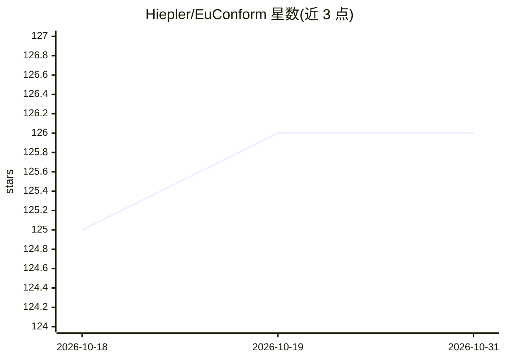

# Hiepler/EuConform

⭐ 126 · TypeScript · MIT · 推送 2026-10-30 · [GitHub](https://github.com/Hiepler/EuConform) · [官网](https://euconform.eu) · 个人维护

**面向 EU AI Act 的开源合规证据工具：风险分类与偏见测试**

基于 Next.js/TypeScript 的 EU AI Act (Regulation 2024/1689) 合规证据工具：定义开放证据格式（report/aibom/ci/bundle 四类 JSON 文档），提供 CLI 从代码库扫描生成结构化证据、按公开 schema 验证文档、校验 bundle 完整性、导入 CycloneDX SBOM 至 AI BOM 层。基于 CrowS-Pairs 方法对本地 Ollama 模型做离线偏见评测（log-probability 为主、延迟为回退），Web 界面提供 Article 5/6/Annex III 风险分类问答。覆盖 Art. 5/6–15/Annex IV，声明仅提供技术指引不构成法律意见。

## 筛选速览

| 维度 | 判定 | 备注 |
|---|---|---|
| AI 角色 | `ai-ecosystem` | LLM/agent 周边工具 |
| 许可风险 | `permissive` | MIT |
| 部署形态 | `None` |  |
| 模型依赖 | local-ok | 支持本地模型 |
| 硬件要求 | — | 无带数字的原话,不猜 |
| 安装摩擦 | `low` | 无编译、无系统依赖或容器化 |
| 成熟度 | `idea` | |

## 能力要点

- scan/validate/verify/bias/import 五个 CLI 命令生成与校验可移植合规证据
- CrowS-Pairs 方法对本地 Ollama 模型做离线可复现偏见评测
- 交互式问答实现 EU AI Act Article 5 禁止类与 Annex III 高风险分类
- 导入外部 CycloneDX SBOM 并映射到 AI BOM 层

## 适用场景

- 为开源或内部 AI 项目生成 EU AI Act 技术文档与合规证据
- 在 CI 中以 scan 结果做合规门禁与 GitHub 注解
- 模型更新前后本地跑偏见评测留档
- 向审计方交付可验证的 bundle 证据包

## 场景标签

`模型评测` · 领域:评测与运维

## 证据(README 行号)

> L28:  EuConform defines an open evidence format for AI compliance and provides the tools to produce, validate, and empir
> L62: |`bias`|Bias report JSON and/or Markdown|Run reproducible local model evaluation with Ollama — EuConform's distinct
> L217: > [!NOTE]

## 星数曲线

2026-10-18 125 → 2026-10-31 126（+1）

---
*卡片 v1 · prompt 1.4 · 生成 2026-10-23 · 置信度 high · 依据 README sha `71bbc2b0a2aa` · [字段定义](../../DATASET.md)*
