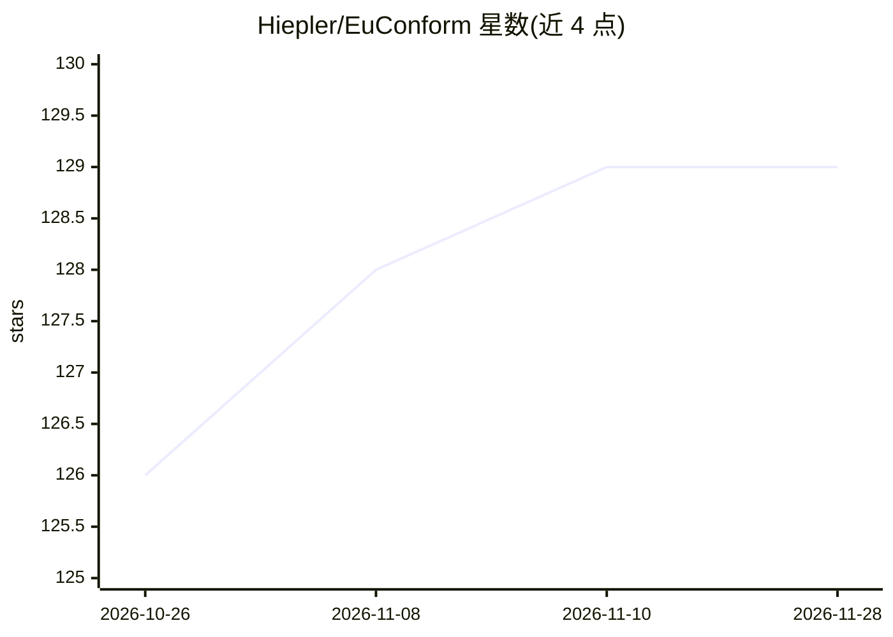

# Hiepler/EuConform

⭐ 129 · TypeScript · MIT · 推送 2026-11-11 · [GitHub](https://github.com/Hiepler/EuConform) · [官网](https://euconform.eu) · 个人维护

**给 AI 合规团队提供 EU AI Act 风险分级与偏见测试的开源工具包**

EuConform 定义开放的 AI 合规证据格式，并提供生成、校验与实证评估工具。CLI 提供 scan（从代码库生成 report/aibom/ci/bundle 四类 JSON 工件）、bias（基于 CrowS-Pairs 经 transformers.js 本地计算句子 log-probability 的模型偏见评估）、compare（两次偏差评估的显著性对比）、validate/verify（schema 与 bundle 完整性校验）、import（导入 CycloneDX SBOM）等命令；Web 端提供 EU AI Act Art.5/Art.6+Annex III 的交互式风险分级问答。核心流程离线运行、无供应商依赖；README 声明仅提供技术指导、不构成法律意见。

## 筛选速览

| 维度 | 判定 | 备注 |
|---|---|---|
| AI 角色 | `ai-ecosystem` | LLM/agent 周边工具 |
| 许可风险 | `permissive` | MIT |
| 部署形态 | `None` |  |
| 模型依赖 | — | README 未给出锁定关系 |
| 硬件要求 | — | 无带数字的原话,不猜 |
| 安装摩擦 | `low` | 无编译、无系统依赖或容器化 |
| 成熟度 | — | 结构信号不足 |

## 能力要点

- 实现 EU AI Act Art.5、Art.6–7+Annex III、Art.10 等条款的合规覆盖
- 基于 CrowS-Pairs 与 transformers.js 的本地偏见评估，离线可复现
- scan/validate/verify/import 构成证据工件的生成与校验链
- GitHub Actions 集成输出注解、摘要与机读 CI 工件

## 适用场景

- 为内部 AI 项目收集欧盟 AI 法案合规证据并做风险分级
- 模型更新前后对比偏见评估结果并做显著性检验
- 在 CI 中设置合规门禁并生成审计工件
- 把外部 CycloneDX SBOM 映射为 AI BOM 清单

## 场景标签

`模型评测` · 领域:评测与运维

## 证据(README 行号)

> L28:  EuConform defines an open evidence format for AI compliance and provides the tools to produce, validate, and empir
> L49: |🎯 **Risk Classification**|Interactive quiz implementing EU AI Act Article 5 (prohibited), Article 6 + Annex III (h
> L62: |`bias`|Bias report JSON and/or Markdown|Run reproducible local model evaluation via transformers.js — EuConform's 

## 星数曲线

2026-10-26 126 → 2026-11-28 129（+3）

---
*卡片 v1 · prompt 1.4 · 生成 2026-11-28 · 置信度 high · 依据 README sha `5fc959eaf24b` · [字段定义](../../DATASET.md)*
