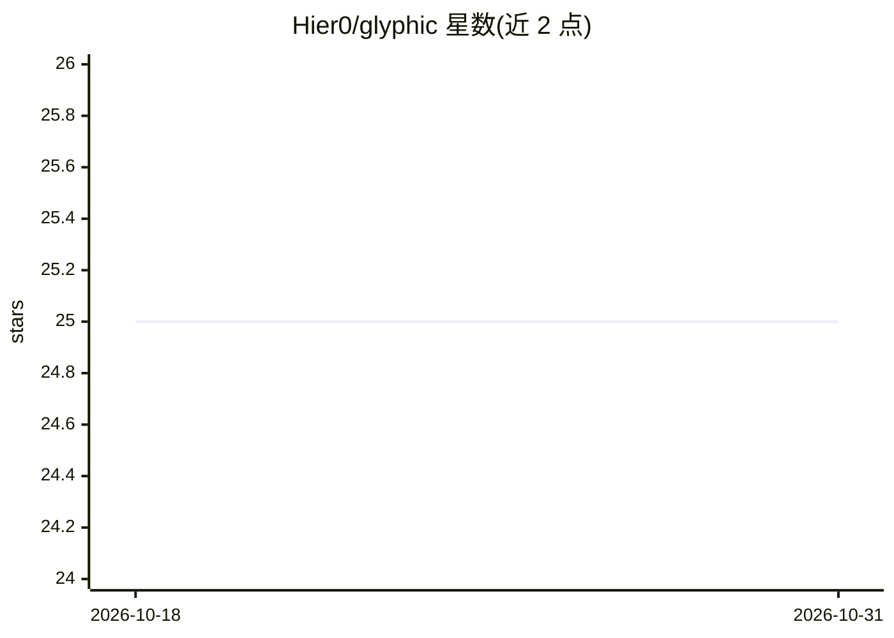

# Hier0/glyphic

⭐ 25 · TypeScript · GPL-3.0 · 推送 2025-12-10 · [GitHub](https://github.com/Hier0/glyphic) · [官网](https://hiero.gl) · 个人维护

**本地构建与管理 AI 工作流的开源平台（早期开发中）**

面向需要在本地机器上创建、管理和执行 AI 工作流的用户，定位为 Gumloop 等平台的开源替代，强调隐私、本地执行与无云依赖。计划提供可视化工作流构建器、独立可执行文件与工作流导出能力：导出为 CrewAI 代理、Swarm AI 模式，或转换为 AutoGen、LangChain 序列、MetaGPT 格式。README 自述处于极早期阶段，路线图各阶段均未勾选完成，尚无安装命令与发布产物。

## 筛选速览

| 维度 | 判定 | 备注 |
|---|---|---|
| AI 角色 | `ai-ecosystem` | LLM/agent 周边工具 |
| 许可风险 | `viral` | GPL-3.0 |
| 部署形态 | `None` |  |
| 模型依赖 | — | README 未给出锁定关系 |
| 硬件要求 | — | 无带数字的原话,不猜 |
| 安装摩擦 | `low` | 无编译、无系统依赖或容器化 |
| 成熟度 | `idea` | |

## 能力要点

- 工作流可导出为 CrewAI/Swarm AI/AutoGen/LangChain/MetaGPT 等框架格式
- 全本地执行，数据不离开本机
- 计划提供独立可执行文件与可视化工作流设计器

## 适用场景

- 在本地搭建和运行 AI 自动化工作流而不依赖云服务
- 将可视化搭建的工作流导出到现有 agent 框架中使用

## 场景标签

`工作流自动化` · 领域:效率与自动化

## 证据(README 行号)

> L5: Glyphic is an open-source platform for creating, managing, and executing AI workflows locally and securely. Think of
> L24: ### CrewAI Integration

## 星数曲线

2026-10-18 25 → 2026-10-31 25（+0）

---
*卡片 v1 · prompt 1.4 · 生成 2026-10-27 · 置信度 mid · 依据 README sha `0fa0233de074` · [字段定义](../../DATASET.md)*
