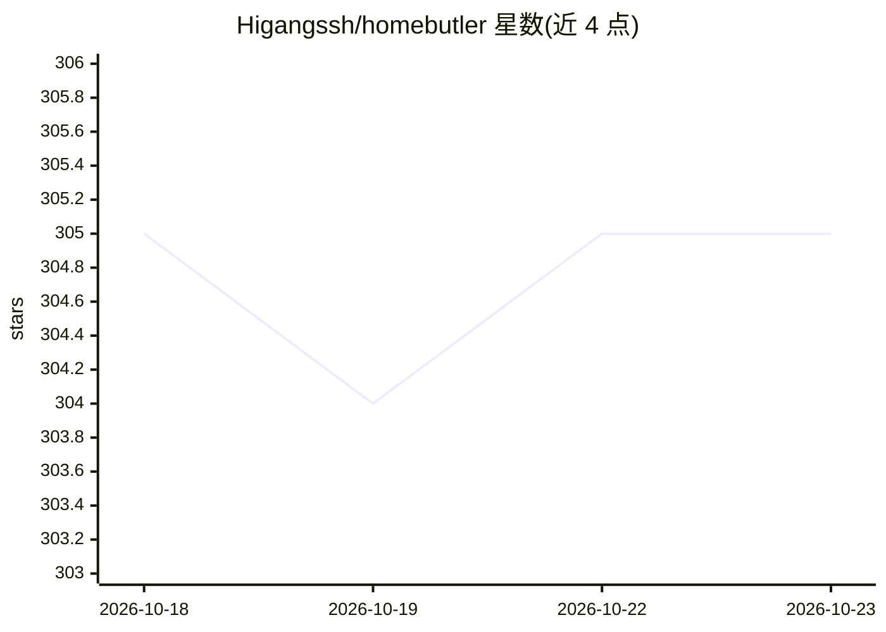

# Higangssh/homebutler

⭐ 305 · Go · MIT · 推送 2026-10-17 · [GitHub](https://github.com/Higangssh/homebutler) · [官网](https://homebutler.dev) · 个人维护

**单二进制服务器变更检测与运维工具，内置 MCP server**

用 Go 编写的单二进制 homelab 运维工具：通过 SSH 在被监控机器上按需运行，无守护进程、无数据库。核心是快照式变更报告——记录上次服务器状态，对比后按八种变更类型（gone/new/replaced/image/state/port/disk/skipped）输出值得关注的差异，支持 --json 供程序消费。另提供 doctor 预检、进程崩溃监控（Docker/systemd/PM2）、备份恢复演练（隔离容器启动并要求 HTTP 健康检查通过）、应用一键部署、Proxmox 集群查看。内置 MCP server，让 AI agent 通过结构化接口而非 SSH 检查服务器；变更判定为书面规则而非模型。

## 筛选速览

| 维度 | 判定 | 备注 |
|---|---|---|
| AI 角色 | `ai-enhanced` | 去掉 AI 部分产品仍成立 |
| 许可风险 | `permissive` | MIT |
| 部署形态 | `self-host` | docker 或自建部署 |
| 模型依赖 | — | README 未给出锁定关系 |
| 硬件要求 | — | 无带数字的原话,不猜 |
| 安装摩擦 | `low` | 无编译、无系统依赖或容器化 |
| 成熟度 | — | 结构信号不足 |

## 能力要点

- 快照对比式变更报告，八种变更类型并有 --json 输出
- backup drill 将备份档案在隔离容器中启动并通过 HTTP 健康检查验证可恢复性
- watch 捕获 Docker/systemd/PM2 重启前后的日志并检测抖动循环
- 内置 MCP server，AI agent 无需 SSH 即可检查服务器

## 适用场景

- 巡检 homelab，回答'上次到现在什么变了、要不要紧'
- cron 定期跑 doctor 预检磁盘、暴露端口与备份健康
- 让 AI 助手通过 MCP 读取服务器状态而不给它完整 shell
- 验证备份档案真的能恢复

## 场景标签

 · 领域:运维工具/自托管服务器管理

## 证据(README 行号)

> L103: - **The judgement is a written rule, not a model.** What earns a line is in docs/report.md, and the same input giv
> L151: - **Use it anywhere** — CLI, JSON, web dashboard, or MCP for AI agents without giving them SSH

## 星数曲线

2026-10-18 305 → 2026-10-23 305（+0）

---
*卡片 v1 · prompt 1.4 · 生成 2026-10-21 · 置信度 low · 依据 README sha `38e17178c88d` · [字段定义](../../DATASET.md)*
