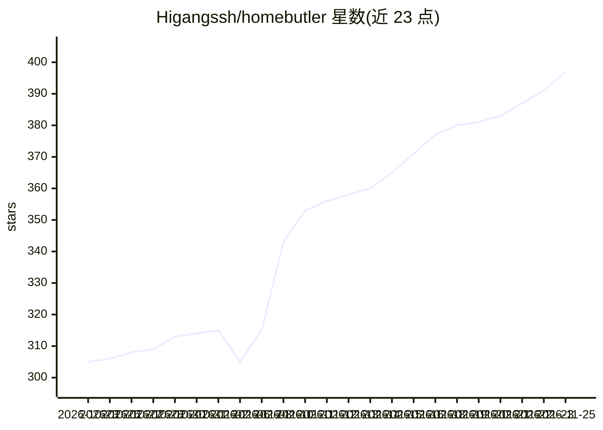

# Higangssh/homebutler

⭐ 397 · Go · MIT · 推送 2026-11-16 · [GitHub](https://github.com/Higangssh/homebutler) · [官网](https://homebutler.dev) · 个人维护

**给 homelab 用户的单二进制服务器变更报告与运维工具，内置 MCP server**

单个 Go 二进制的自托管服务器运维工具：通过快照对比生成变更报告（gone/new/replaced/port/disk 等 8 类变化），提供 doctor 健康检查、backup drill 备份可恢复性验证（在隔离容器中启动归档并要求 HTTP 健康检查通过）、进程崩溃 watch（Docker/systemd/PM2 后端）、应用一键部署与 Proxmox 集群查看。无守护进程、无数据库，被监控机器上不留常驻进程，经 SSH 按需运行。所有输出带 --json，内置 MCP server 供 AI agent 在不授予 SSH shell 的情况下查询服务器。判定规则是书面规则而非模型。

## 筛选速览

| 维度 | 判定 | 备注 |
|---|---|---|
| AI 角色 | `ai-enhanced` | 去掉 AI 部分产品仍成立 |
| 许可风险 | `permissive` | MIT |
| 部署形态 | `desktop` | 安装包/桌面程序 |
| 模型依赖 | — | README 未给出锁定关系 |
| 硬件要求 | — | 无带数字的原话,不猜 |
| 安装摩擦 | `low` | 无编译、无系统依赖或容器化 |
| 成熟度 | — | 结构信号不足 |

## 能力要点

- 快照对比变更报告，replaced 类型识别同名容器被替换
- backup drill 在隔离容器启动备份并要求 HTTP 健康检查
- doctor/config validate 只读检查，每个发现附下一条命令
- 全命令支持 --json 输出，内置 MCP server

## 适用场景

- 弄清服务器自上次以来发生了什么变化
- 验证备份是否真的能恢复
- 让 AI 助手检查服务器而不给它 SSH shell
- 通过 cron 定时监控容器崩溃与重启原因

## 场景标签

 · 领域:运维/自托管工具

## 证据(README 行号)

> L103: - **The judgement is a written rule, not a model.** What earns a line is in docs/report.md, and the same input giv
> L152: - **Use it anywhere** — CLI, JSON, web dashboard, or MCP for AI agents without giving them SSH

## 星数曲线

2026-10-23 305 → 2026-11-25 397（+92）

---
*卡片 v1 · prompt 1.4 · 生成 2026-11-25 · 置信度 mid · 依据 README sha `a71c65e1cd2d` · [字段定义](../../DATASET.md)*
