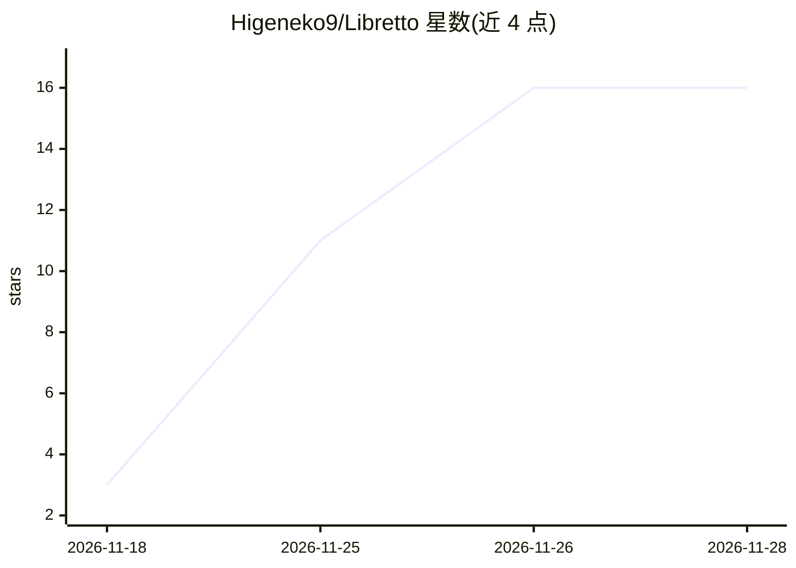

# Higeneko9/Libretto

⭐ 16 · TypeScript · MIT · 推送 2026-11-23 · [GitHub](https://github.com/Higeneko9/Libretto) · 个人维护

**为 ComfyUI 用户提供节点式图像提示词组装与生成管理桌面工具**

Libretto 是面向 ComfyUI 用户的节点式提示词生成工具：把角色、服装、姿势、场景、光照等可复用预设拖入图编辑器组装提示词，按剧（show/act/scene）组织场景与历史，并生成、重排或撤销组织结构。它本身不做图像生成，而是将提示词与种子、尺寸、采样参数填入从 ComfyUI 服务器导入的工作流，由独立运行的 ComfyUI 完成生成并展示结果。提供 Windows/macOS/Linux 桌面安装包，内嵌运行时，无需安装 Python 或 Node.js；UI 支持多语言。

## 筛选速览

| 维度 | 判定 | 备注 |
|---|---|---|
| AI 角色 | `ai-enhanced` | 去掉 AI 部分产品仍成立 |
| 许可风险 | `permissive` | MIT |
| 部署形态 | `desktop` | 安装包/桌面程序 |
| 模型依赖 | — | README 未给出锁定关系 |
| 硬件要求 | — | 无带数字的原话,不猜 |
| 安装摩擦 | `low` | 无编译、无系统依赖或容器化 |
| 成熟度 | — | 结构信号不足 |

## 能力要点

- 节点式提示词组装：预设卡片拖入图编辑器，生成正/负提示词
- 导入 ComfyUI 工作流转为 API 格式作为模型 profile，保留其余工作流结构
- show/act/scene 组织结构、可共享文件夹、组织级撤销（保留 100 步）
- Windows 安装包、macOS 公证 dmg、deb 与 AppImage，无需 Python/Node.js

## 适用场景

- 用可复用预设批量组装 Stable Diffusion/Flux 提示词场景
- 连接本地或远程 ComfyUI 服务器提交文生图任务并管理输出
- 按剧幕结构组织、导出和共享场景 JSON 与生成结果

## 场景标签

`提示工程` `图像生成` · 领域:Agent 开发

## 证据(README 行号)

> L7: Libretto is a node-based **prompt generation tool** for ComfyUI. Build prompts
> L11: **Libretto is not an image generation engine.** It composes prompts, sends them
> L13: displays the results. ComfyUI performs the image generation using your installed

## 星数曲线

2026-11-18 3 → 2026-11-28 16（+13）

---
*卡片 v1 · prompt 1.4 · 生成 2026-11-24 · 置信度 mid · 依据 README sha `b3914587f0e7` · [字段定义](../../DATASET.md)*
