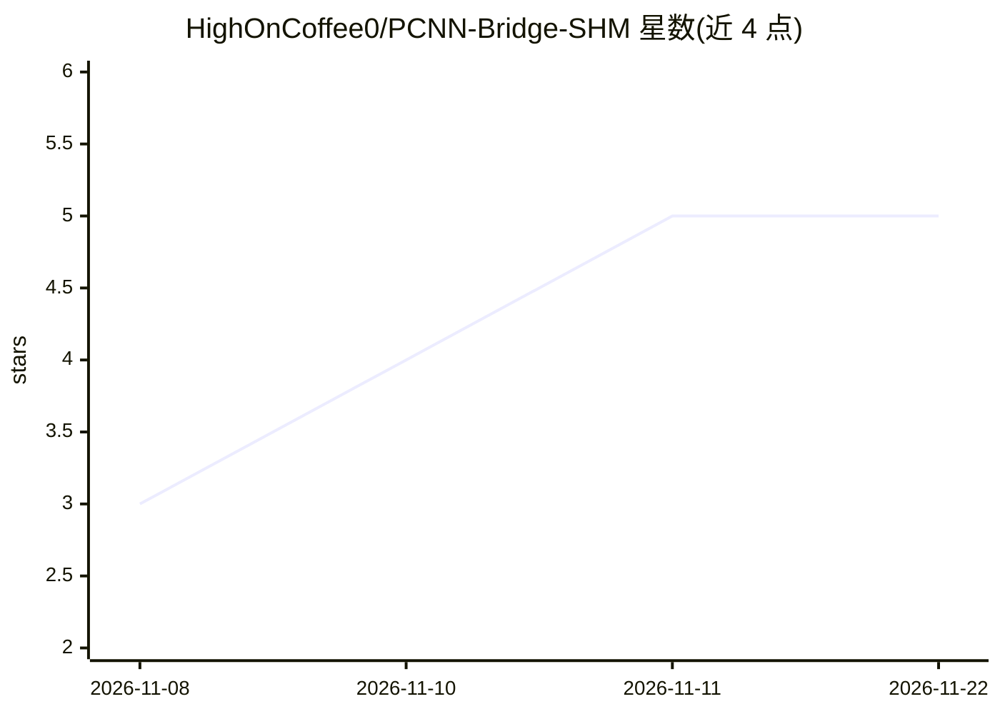

# HighOnCoffee0/PCNN-Bridge-SHM

⭐ 5 · Python · MIT · 推送 2026-11-11 · [GitHub](https://github.com/HighOnCoffee0/PCNN-Bridge-SHM) · 个人维护

**桥梁结构健康监测的物理约束神经网络预测模型**

多输出头物理约束神经网络，从载荷、温度、振动与时间输入预测应变、缆索张力与结构健康指数（SHI），物理项为可学习常数的代数关系（OLS 拟合起步），并通过 MC Dropout（T=50）给出 95% 区间与 Poor/Fair/Good 健康等级概率。数据为 Kaggle 合成数字孪生数据集（43,200 行，30 天），按时间顺序划分以防泄漏；含消融实验与校准指标。局限：合成数据、测试集无极端载荷、张力区间过于自信。

## 筛选速览

| 维度 | 判定 | 备注 |
|---|---|---|
| AI 角色 | `ai-native` | 本体是模型或模型工具 |
| 许可风险 | `permissive` | MIT |
| 部署形态 | `library` | 以包/库形式分发 |
| 模型依赖 | — | README 未给出锁定关系 |
| 硬件要求 | — | 无带数字的原话,不猜 |
| 安装摩擦 | `low` | 无编译、无系统依赖或容器化 |
| 成熟度 | — | 结构信号不足 |

## 能力要点

- 可学习物理常数的多任务损失（3 数据项 + 2 物理项）
- MC Dropout T=50 输出 95% 区间与健康等级概率
- Test-before-assume 流程：候选物理关系经 R²、冗余与自相关检验筛选
- 防泄漏流水线：时间顺序划分、归一化与物理系数仅在训练集拟合

## 适用场景

- 从桥梁监测传感器数据预测应变与缆索张力
- 输出结构健康指数并给出分级概率与不确定性区间
- 研究物理约束神经网络在时序监测数据上的消融与校准方法

## 场景标签

`科研工具` · 领域:学习与行业

## 证据(README 行号)

> L3: A multi-head, physics-constrained neural network that predicts **strain**, **cable tension** and the **Structural He
> L107: Total loss: `L = Σᵢ λᵢ · Lᵢ` over five terms: three data losses (strain, tension, SHI) and two physics losses (str
> L213: - Python 3.9+

## 星数曲线

2026-11-08 3 → 2026-11-22 5（+2）

---
*卡片 v1 · prompt 1.4 · 生成 2026-11-21 · 置信度 high · 依据 README sha `b68bf3afeed0` · [字段定义](../../DATASET.md)*
