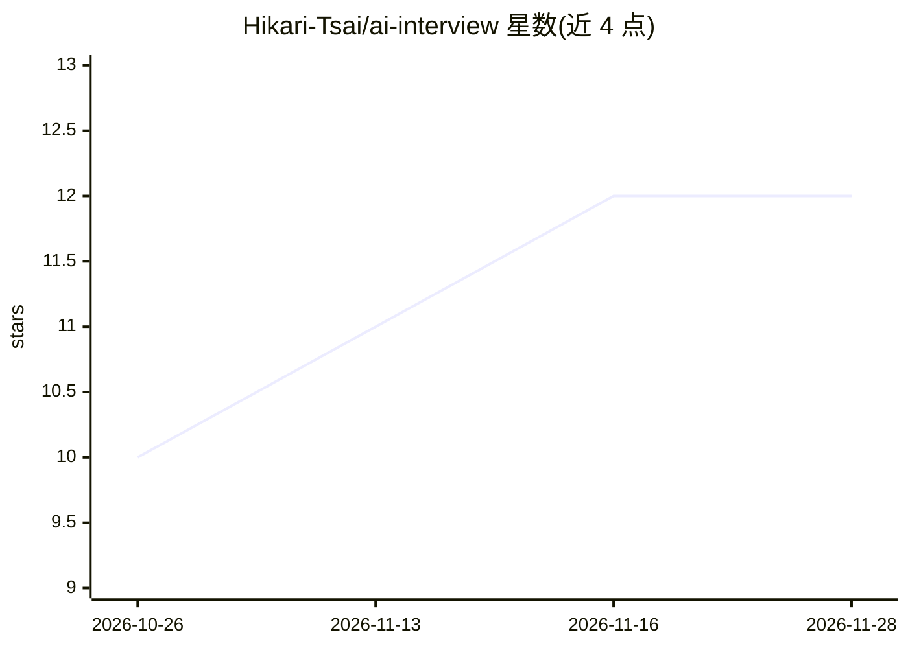

# Hikari-Tsai/ai-interview

⭐ 12 · TypeScript · Apache-2.0 · 推送 2026-11-27 · [GitHub](https://github.com/Hikari-Tsai/ai-interview) · [官网](https://hikari-tsai.github.io/ai-interview) · 个人维护 · 中文 README

**AI 工程面试题库：多语言卡片练习与溯源学习笔记**

598 题的 AI 工程面试题库静态网站，繁中/英文/日文三语界面与学习内容，基于 Astro 和 TypeScript 构建。用 LLM 将原始题目与链接文章浓缩为按「原理→取舍→实现→生产」组织的结构化答案；GitHub Actions 每日跟踪上游仓库增量更新题目并生成答案，答案需通过语言相关的长度、结构与来源链接校验。社区答案独立存储且优先于 AI 输出；网站完全静态，模型调用仅发生在内容生成阶段。题库源自第三方仓库，非本项目原创。

## 筛选速览

| 维度 | 判定 | 备注 |
|---|---|---|
| AI 角色 | `ai-knowledge` | 知识聚合/清单类 |
| 许可风险 | `permissive` | Apache-2.0 |
| 部署形态 | `None` |  |
| 模型依赖 | — | README 未给出锁定关系 |
| 硬件要求 | — | 无带数字的原话,不猜 |
| 安装摩擦 | `low` | 无编译、无系统依赖或容器化 |
| 成熟度 | — | 结构信号不足 |

## 能力要点

- 598 题多语言（繁中/英/日）闪卡练习界面
- LLM 生成的结构化答案按 原理→取舍→实现→生产 组织，并保留来源链接与 commit 锚定
- GitHub Actions 每日增量同步上游并重试未完成的答案生成（每次运行最多 10 次模型尝试）
- 社区答案独立存储、优先展示且不被自动生成覆盖

## 适用场景

- 按主题标签、公司或关键词筛选练习 AI 工程面试题
- 逐题练习、请求提示、展开结构化答案
- 以 Issue 表单或 PR 贡献答案参与社区共建

## 场景标签

`教程课程` · 领域:学习与行业

## 证据(README 行号)

> L5: Recall is an **AI interview question bank** and an independent community edition of AI Engineering Interview Questio
> L32: The dataset contains **598 questions**. Select **With answers** to practice questions with an answer in the current
> L76: This project adds structured question records, stable question numbers, tags, the flashcard interface, translations

## 星数曲线

2026-10-26 10 → 2026-11-28 12（+2）

---
*卡片 v1 · prompt 1.4 · 生成 2026-11-18 · 置信度 high · 依据 README sha `5a4c0a15df1f` · [字段定义](../../DATASET.md)*
