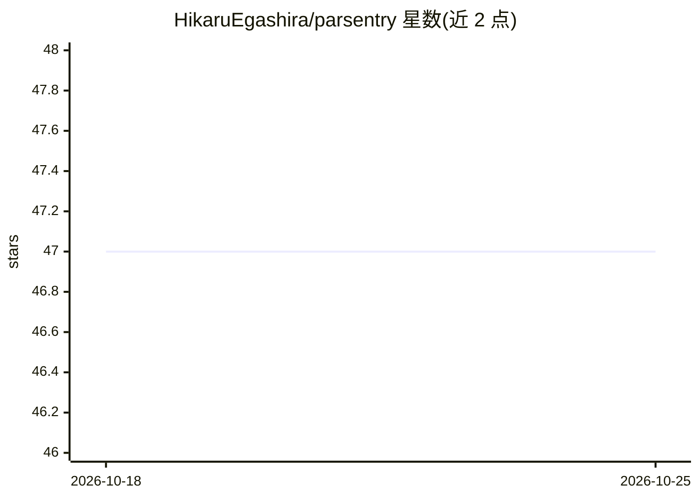

# HikaruEgashira/parsentry

⭐ 47 · Rust · AGPL-3.0 · 推送 2026-10-19 · [GitHub](https://github.com/HikaruEgashira/parsentry) · [官网](https://hikaruegashira.github.io/parsentry/) · 个人维护

**为 CLI AI 代理编排安全扫描的工具，生成威胁模型与并行分析提示**

Rust 实现的安全扫描编排器：读取仓库结构与源代码，枚举攻击面，生成威胁模型提示与按攻击面切分的 .prompt.md 文件，输出编排提示符到 stdout，可管道给任意 CLI 代理（如 claude -p）调度并行子代理执行分析并产出 SARIF 结果；附带实时监控扫描进度的 log 命令。可通过 mise 或 cargo 安装，也提供 agent skill（npx skills add）形式供 Claude 类代理调用。

## 筛选速览

| 维度 | 判定 | 备注 |
|---|---|---|
| AI 角色 | `ai-ecosystem` | LLM/agent 周边工具 |
| 许可风险 | `viral` | AGPL-3.0 |
| 部署形态 | `self-host` | docker 或自建部署 |
| 模型依赖 | — | README 未给出锁定关系 |
| 硬件要求 | — | 无带数字的原话,不猜 |
| 安装摩擦 | `low` | 无编译、无系统依赖或容器化 |
| 成熟度 | — | 结构信号不足 |

## 能力要点

- 读取仓库元数据生成威胁模型提示
- 按攻击面生成 .prompt.md 并输出编排提示供 CLI 代理调度并行子代理
- 扫描结果以 SARIF 格式输出
- 支持 mise/cargo 安装，并提供 agent skill 分发

## 适用场景

- 让 CLI 代理对仓库做按攻击面切分的并行安全审计
- 生成仓库威胁模型提示供代理枚举攻击面
- 实时监控安全扫描进度

## 场景标签

`网络安全` `代码审查` · 领域:编码与开发

## 证据(README 行号)

> L3: **Security Scan orchestrator for AI Agents.**
> L24: `model` produces a threat model, `scan` generates per-surface prompts and outputs an orchestrator prompt to stdout.

## 星数曲线

2026-10-18 47 → 2026-10-25 47（+0）

---
*卡片 v1 · prompt 1.4 · 生成 2026-10-25 · 置信度 mid · 依据 README sha `7016b53117c8` · [字段定义](../../DATASET.md)*
