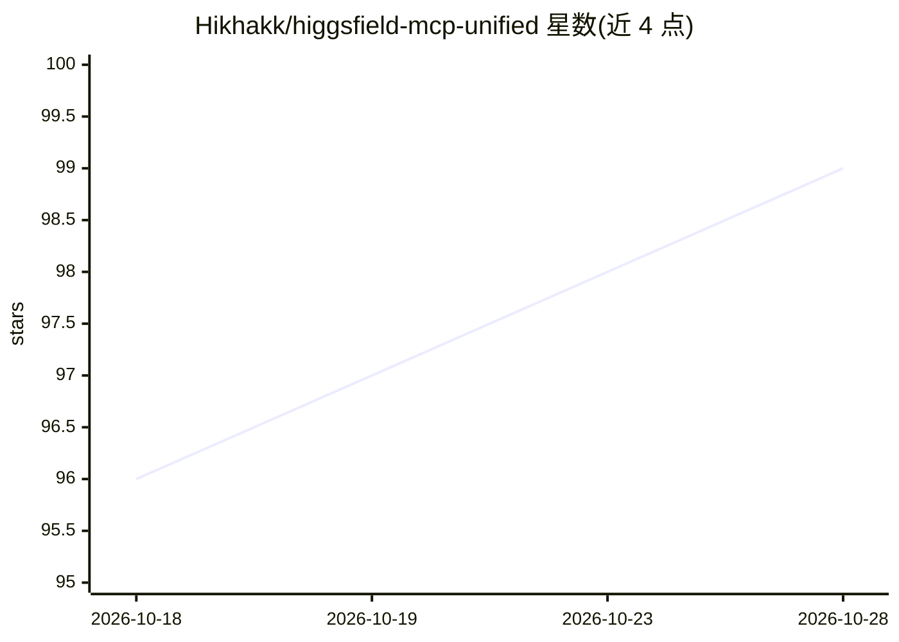

# Hikhakk/higgsfield-mcp-unified

⭐ 100 · Python · MIT · 推送 2026-10-17 · [GitHub](https://github.com/Hikhakk/higgsfield-mcp-unified) · [官网](https://docs.higgsfield.ai/docs) · 个人维护

**本地优先的 Higgsfield AI MCP 服务器：85 个图像视频模型统一接入**

面向 MCP 客户端（Claude Desktop/Code、Cursor 等）的 Model Context Protocol 服务器，把 Higgsfield 官方 API 的 85 个图像/视频生成模型（Seedance、Kling、Wan、Soul 等）封装为带类型化参数与结构化输出的工具面，提供成本估算、参数校验、幂等提交、webhook 回调与 Soul ID 角色训练。另含 opt-in 的逆向工程 web 后端（Sora 2、Veo 3 等 34 个消费端模型），README 明示该路径脆弱且可能违反服务条款。以 PyPI 包（uvx/pip）或源码运行，需 Higgsfield API key。项目自述为 alpha 状态。

## 筛选速览

| 维度 | 判定 | 备注 |
|---|---|---|
| AI 角色 | `ai-ecosystem` | LLM/agent 周边工具 |
| 许可风险 | `permissive` | MIT |
| 部署形态 | `library` | 以包/库形式分发 |
| 模型依赖 | — | README 未给出锁定关系 |
| 硬件要求 | — | 无带数字的原话,不猜 |
| 安装摩擦 | `low` | 无编译、无系统依赖或容器化 |
| 成熟度 | `idea` | |

## 能力要点

- 85 个官方 API 模型带参数 schema、枚举与默认值
- estimate_cost / validate_params / preflight_check 等免消耗的发现工具
- 幂等键、退避重试、熔断与类型化错误
- opt-in web 后端接入 34 个消费端模型（Sora 2、Veo 3 等）

## 适用场景

- 在 Claude Desktop/Code 或 Cursor 中调用 Higgsfield 图像视频生成
- 生成前预估 credits 成本与校验参数，避免误花额度
- 训练 Soul ID 角色并复用于角色生成

## 场景标签

`图像生成` `视频生成` · 领域:内容生成

## 证据(README 行号)

> L3: A local-first Model Context Protocol server for Higgsfield AI.
> L5: Soul character training, webhooks, cost estimates and preset catalogs sit behind the same typed tool surface, which 
> L13: The official hosted MCP (`mcp.higgsfield.ai`) runs on Higgsfield's servers behind OAuth.

## 星数曲线

2026-10-18 96 → 2026-10-28 99（+3）

---
*卡片 v1 · prompt 1.4 · 生成 2026-10-23 · 置信度 high · 依据 README sha `941774c61c8e` · [字段定义](../../DATASET.md)*
