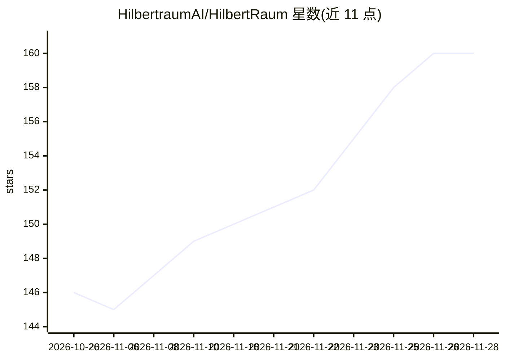

# HilbertraumAI/HilbertRaum

⭐ 160 · TypeScript · GPL-3.0 · 推送 2026-11-27 · [GitHub](https://github.com/HilbertraumAI/HilbertRaum) · [官网](https://hilbertraum.ai/) · 组织维护

**完全离线运行的本地 AI 工作区：聊天、文档问答、离线维基**

基于 Electron 的桌面应用，在本地运行 llama.cpp 引擎与 GGUF 模型，提供本地聊天、PDF/Word 文档问答（向量+关键词检索+重排序）、离线 Wikipedia（ZIM/kiwix）、Whisper 语音转录、视觉模型图像理解、本地翻译（TranslateGemma）与证据复核导出。支持 Windows/macOS/Linux，数据加密可移植到 USB 盘，无云端与遥测；应用检测硬件自动推荐模型，Linux 需 glibc 2.34、OpenSSL 3 等系统库。

## 筛选速览

| 维度 | 判定 | 备注 |
|---|---|---|
| AI 角色 | `ai-native` | 本体是模型或模型工具 |
| 许可风险 | `viral` | GPL-3.0 |
| 部署形态 | `desktop` | 安装包/桌面程序 |
| 模型依赖 | local-ok | 支持本地模型 |
| 硬件要求 | `cpu-ok` | |
| 安装摩擦 | `medium` | 含编译或系统依赖之一 |
| 成熟度 | `idea` | |

## 能力要点

- 本地 llama.cpp 引擎运行 GGUF 模型，自动基准测试并按 RAM/VRAM 推荐模型
- 文档问答带引用来源，检索结合向量与关键词搜索及重排序
- ZIM 档案（Wikipedia 约100种语言）作为离线知识源随文档一同检索引用
- OpenAI 兼容的本地回环 API（默认关闭，仅暴露 completions）

## 适用场景

- 在无网络环境下使用 AI 聊天与文档问答
- 对私人文档提问并要求答案带来源引用
- 便携盘携带整套 AI 应用与模型在多台机器使用
- 离线查阅多语言 Wikipedia 并与本地文档联合检索

## 场景标签

`文档问答` `语音识别` `聊天机器人` · 领域:对话与助手

## 证据(README 行号)

> L15: **HilbertRaum is a private AI workspace that runs locally on your computer and can operate entirely offline.** Chat
> L24: - 🧠 **Local models.** A `llama.cpp` runtime with GGUF models from a curated open-weight catalog
> L26: - 📄 **Document Q&A with citations.** Import PDFs, Word files, or text, ask questions, and get

## 星数曲线

2026-10-26 146 → 2026-11-28 160（+14）

---
*卡片 v1 · prompt 1.4 · 生成 2026-11-27 · 置信度 high · 依据 README sha `78d9bd77dd5d` · [字段定义](../../DATASET.md)*
