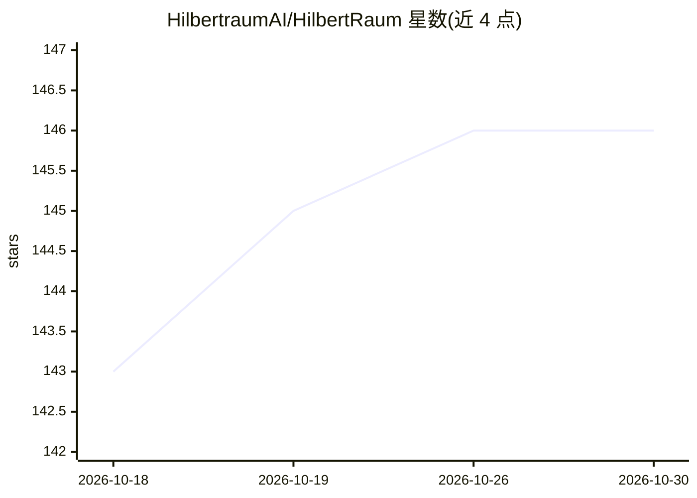

# HilbertraumAI/HilbertRaum

⭐ 146 · TypeScript · GPL-3.0 · 推送 2026-10-29 · [GitHub](https://github.com/HilbertraumAI/HilbertRaum) · [官网](https://hilbertraum.ai/) · 组织维护

**完全离线运行的私有 AI 工作区：本地对话、文档问答与离线维基**

基于 Electron/React/TypeScript 的跨平台桌面应用，面向需要数据不出本机的用户：内置 llama.cpp 运行时加载 GGUF 模型，提供本地聊天、带引用的文档问答（向量+关键词检索加 reranker）、图像理解、Whisper 语音转录、翻译与 OCR。工作区密码加密且可放在外置硬盘在机器间迁移；可注册 ZIM 离线维基作为问答来源。限制：模型与运行时需另行下载（一条脚本或应用内引导），Windows/macOS 构建尚未签名，首个正式发布前的手工发布测试仍在进行。

## 筛选速览

| 维度 | 判定 | 备注 |
|---|---|---|
| AI 角色 | `ai-native` | 本体是模型或模型工具 |
| 许可风险 | `viral` | GPL-3.0 |
| 部署形态 | `desktop` | 安装包/桌面程序 |
| 模型依赖 | local-ok | 支持本地模型 |
| 硬件要求 | `cpu-ok` | |
| 安装摩擦 | `medium` | 含编译或系统依赖之一 |
| 成熟度 | `idea` | |

## 能力要点

- 完全离线：无云端回退、无网络搜索、无遥测
- 文档问答带引用，检索为向量+关键词+reranker
- 可选 ZIM 知识包提供约 100 种语言的离线维基百科
- 加密且可移植的工作区，可整体放在 USB 硬盘迁移
- 可选 OpenAI 兼容本地回环 API（127.0.0.1:4980/v1）

## 适用场景

- 在无网络或要求数据不出本机的环境下用 AI 处理私人文档
- 把带加密工作区的整套 AI 环境装在外置硬盘上换电脑使用
- 离线查询维基百科并让回答附文档引用

## 场景标签

`文档问答` `聊天机器人` `语音识别` `OCR` · 领域:对话与助手

## 证据(README 行号)

> L15: **HilbertRaum is a private AI workspace that runs locally on your computer and can operate entirely offline.** Chat
> L26: - 📄 **Document Q&A with citations.** Import PDFs, Word files, or text, ask questions, and get

## 星数曲线

2026-10-18 143 → 2026-10-30 146（+3）

---
*卡片 v1 · prompt 1.4 · 生成 2026-10-22 · 置信度 mid · 依据 README sha `b5b0d63150f1` · [字段定义](../../DATASET.md)*
