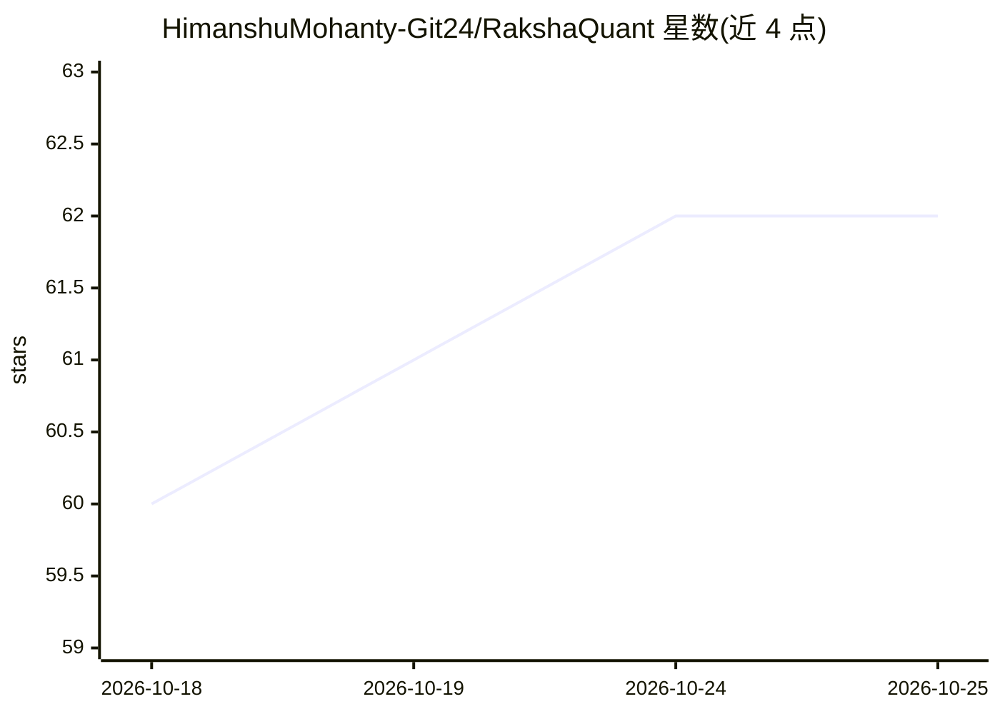

# HimanshuMohanty-Git24/RakshaQuant

⭐ 62 · Python · MIT · 推送 2026-10-23 · [GitHub](https://github.com/HimanshuMohanty-Git24/RakshaQuant) · [官网](https://youtu.be/engyTBg7iK8) · 个人维护

**NSE 股票纸面交易平台：用配对账本实验测量 AI 否决是否增值**

面向研究与教育场景的印度 NSE 股票 agentic 纸面交易平台，核心是一个受控实验：确定性引擎对相同信号交易三个配对账本——A 无顾问基线、B 本地校准决策模型（Laya，可升级至 Jev）、C 任意 LLM（OpenAI/OpenRouter/Groq/Ollama 等）作为否决者。AI 只能否决下单，失败时回退确定性决策，每个买入信号生成反事实交易以评估否决价值。含 34 项风险限制、SQLite 事件溯源、模拟撮合与本地 Web 控制台；无真实券商通道。

## 筛选速览

| 维度 | 判定 | 备注 |
|---|---|---|
| AI 角色 | `ai-enhanced` | 去掉 AI 部分产品仍成立 |
| 许可风险 | `permissive` | MIT |
| 部署形态 | `None` |  |
| 模型依赖 | — | README 未给出锁定关系 |
| 硬件要求 | — | 无带数字的原话,不猜 |
| 安装摩擦 | `low` | 无编译、无系统依赖或容器化 |
| 成熟度 | — | 结构信号不足 |

## 能力要点

- 三配对账本对照实验，以净 AI 价值（相对基线 P&L 减 AI 开销）度量
- AI 只能否决：不下单、不定价、失败回退确定性决策，附带反事实评分
- 34 项有界风险限制、闩锁式 kill switch 与事件溯源审计轨迹
- 本地 Web 交易终端：决策检查器、风险中心、AI 台与实验视图

## 适用场景

- 用配对账本实验检验 LLM 否决对交易系统的净价值
- 在无真实资金风险的模拟环境中跑 NSE 纸面交易日
- 审查每笔信号的完整决策、风险检查与反事实记录

## 场景标签

`金融量化` · 领域:学习与行业

## 证据(README 行号)

> L42: |⚪|**A**|none|The baseline: every entry the strategies and risk rules allow|
> L47: > **AI can only veto.** It never sizes, prices or adds an order. Any AI failure (timeout, refusal,
> L52: rules fixed in advance, whether each advisor stays. The measure is net AI value (the book's

## 星数曲线

2026-10-18 60 → 2026-10-25 62（+2）

---
*卡片 v1 · prompt 1.4 · 生成 2026-10-24 · 置信度 high · 依据 README sha `dd4ee5a21601` · [字段定义](../../DATASET.md)*
