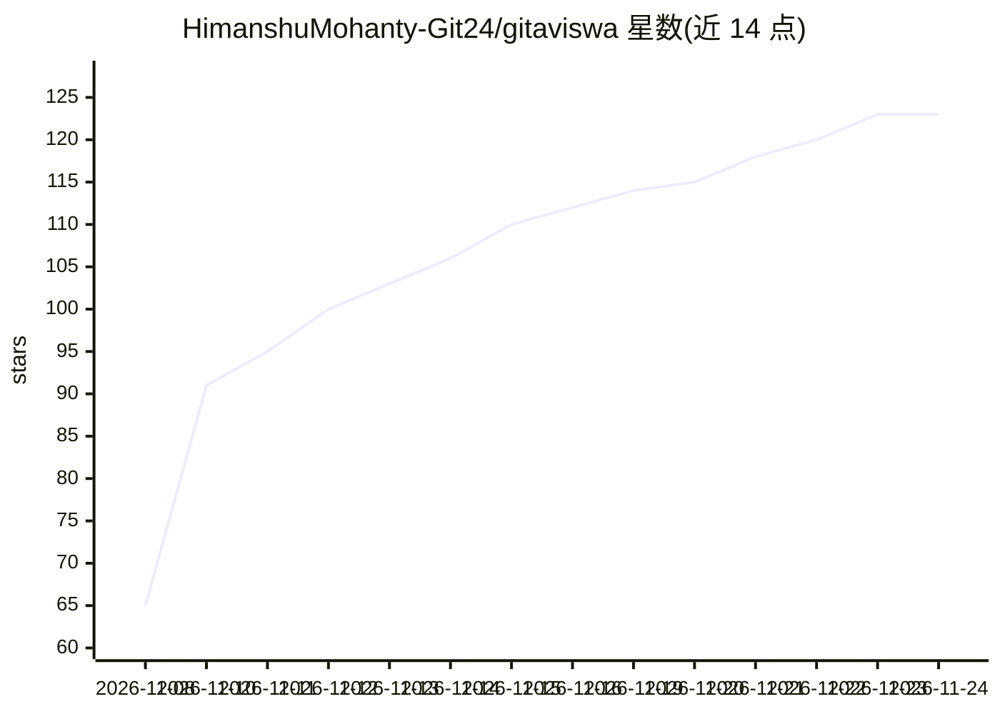

# HimanshuMohanty-Git24/gitaviswa

⭐ 126 · Cypher · MIT · 推送 2026-11-06 · [GitHub](https://github.com/HimanshuMohanty-Git24/gitaviswa) · [官网](https://gitaviswa.vercel.app) · 个人维护

**以 3D 知识图谱呈现《薄伽梵歌》的阅读与问答应用**

面向读者的《薄伽梵歌》Web 应用（Next.js 15）：将 701 颂、概念、心识状态与人生情境组织为可在浏览器中探索的 3D/2D 知识图谱，支持最短路径追踪与谱系视图。阅读视图提供天城体、IAST 及七种地方文字、20 部六派注释对照、颂词诵读播放器与本地保存的日记（IndexedDB）。Ask 功能在浏览器内运行检索（GraphRAG），无 API key 时仅从图谱作答，接入免费 key（Groq/OpenRouter/Ollama 等 BYOK）后可生成带可点击引用的书面回答。除 AI 文本外全部功能可离线使用。

## 筛选速览

| 维度 | 判定 | 备注 |
|---|---|---|
| AI 角色 | `ai-enhanced` | 去掉 AI 部分产品仍成立 |
| 许可风险 | `permissive` | MIT |
| 部署形态 | `library` | 以包/库形式分发 |
| 模型依赖 | local-ok | 支持本地模型 |
| 硬件要求 | — | 无带数字的原话,不猜 |
| 安装摩擦 | `low` | 无编译、无系统依赖或容器化 |
| 成熟度 | — | 结构信号不足 |

## 能力要点

- 701 颂与概念/心识/情境构成 3D 知识图谱，支持节点间最短路径
- 20 部注释（6 派传统）、多文字转写、逐词释义与诵读播放器
- Ask 在浏览器内检索并高亮所用子图，回答带可点击引用
- BYOK 接入 Groq/OpenRouter/Ollama 等，无 key 亦可离线使用大部分功能

## 适用场景

- 以图谱方式探索颂文之间的概念联系与路径
- 对照六派传统的注释阅读每一颂
- 用自己的话向经文提问并获得带出处的回答
- 记录并关联个人思考（本地保存，可导入导出）

## 场景标签

`知识图谱` `文档问答` · 领域:知识与检索

## 证据(README 行号)

> L30: Ask in your own words. GitaViśva finds the verses and ideas that fit, lights them up in the graph, and, if you conn
> L50: Your thoughts in **Reflect** stay on your device. Everything except AI-written answers works without an account, a 
> L134: This step is optional. Without it, everything except AI-written text still works: the graph, the reader, commentar

## 星数曲线

2026-11-08 65 → 2026-11-24 123（+58）

---
*卡片 v1 · prompt 1.4 · 生成 2026-11-17 · 置信度 high · 依据 README sha `804748389964` · [字段定义](../../DATASET.md)*
