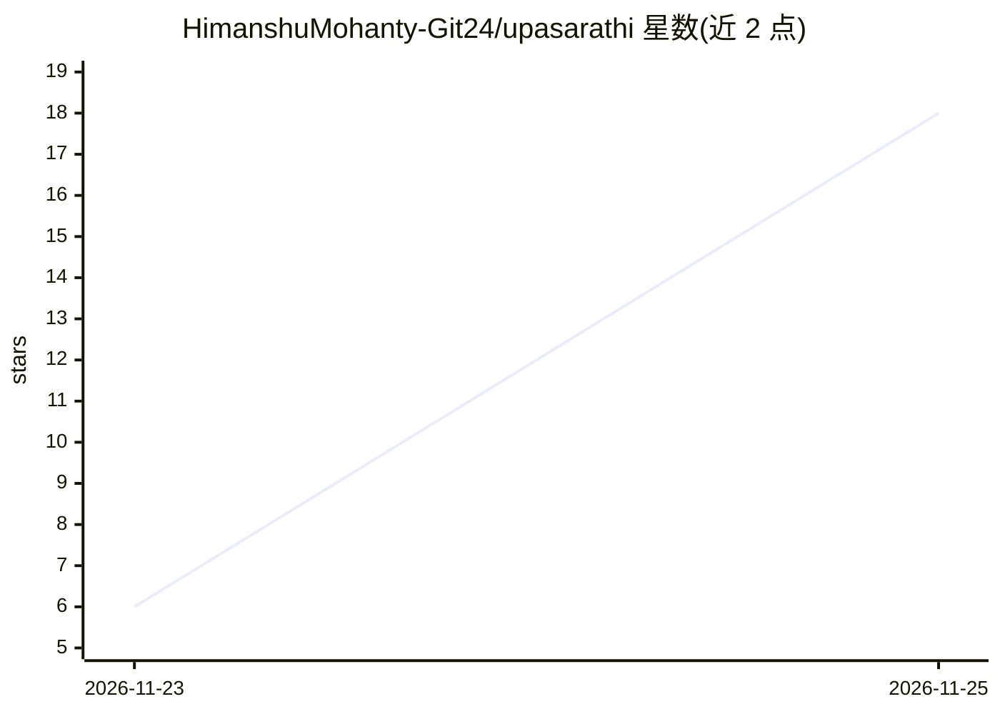

# HimanshuMohanty-Git24/upasarathi

⭐ 18 · TypeScript · MIT · 推送 2026-11-22 · [GitHub](https://github.com/HimanshuMohanty-Git24/upasarathi) · [官网](https://upasarathi.vercel.app/) · 个人维护

**13部奥义书知识图谱阅读站+检测AI迎合倾向的对齐评测工具**

包含两半：其一是13部主要奥义书的完整语料库（1,693段原文+IAST转写+英译+逐词阅读+商羯罗注释+460段人声吟诵），织入含1,998节点、12,252链接的知识图谱，提供焦点地图、3D宇宙视图、路径探索与9种文字实时转写；其二是对齐测试工具：同一模型在基线、诚实控制、图谱证据三种条件下作答，代码核验每条引文是否存在于语料，并由不同模型家族的盲评者按六项指标打分。无需账号或密钥即可使用阅读与图谱功能；提供可下载的独立CLI对任意模型跑基准。

## 筛选速览

| 维度 | 判定 | 备注 |
|---|---|---|
| AI 角色 | `ai-knowledge` | 知识聚合/清单类 |
| 许可风险 | `permissive` | MIT |
| 部署形态 | `library` | 以包/库形式分发 |
| 模型依赖 | local-ok | 支持本地模型 |
| 硬件要求 | — | 无带数字的原话,不猜 |
| 安装摩擦 | `low` | 无编译、无系统依赖或容器化 |
| 成熟度 | — | 结构信号不足 |

## 能力要点

- 13部奥义书全文+逐词阅读+知识图谱（1,998节点/12,252链接）
- 三条件对齐harness：代码核验引文真伪+异族模型盲评
- 独立单文件CLI harness（≈4 MB，内置全部文本与图谱，可断点续跑）
- 浏览器内离线AI：Piper TTS 与 Vāgdhenu 吟诵运行于 WebGPU/ONNX Runtime Web

## 适用场景

- 阅读和检索13部主要奥义书的原文、翻译与注释
- 测试某个模型在诱导下是否选择讨好而非诚实的回答
- 对任意模型批量跑奥义书主题基准并生成报告
- 通过3D图谱探索概念、故事与人物之间的关联路径

## 场景标签

`模型评测` `知识图谱` · 领域:评测与运维

## 证据(README 行号)

> L30: |📖 **A living library**|The 13 Principal Upanishads, complete: **1,693 passages + 13 śānti mantras**, each in Devan
> L31: |⚖️ **An alignment test bench**|Every prompt is answered **three ways by the same model**: a plain baseline, a stro

## 星数曲线

2026-11-23 6 → 2026-11-25 18（+12）

---
*卡片 v1 · prompt 1.4 · 生成 2026-11-23 · 置信度 high · 依据 README sha `208ec463e3fe` · [字段定义](../../DATASET.md)*
