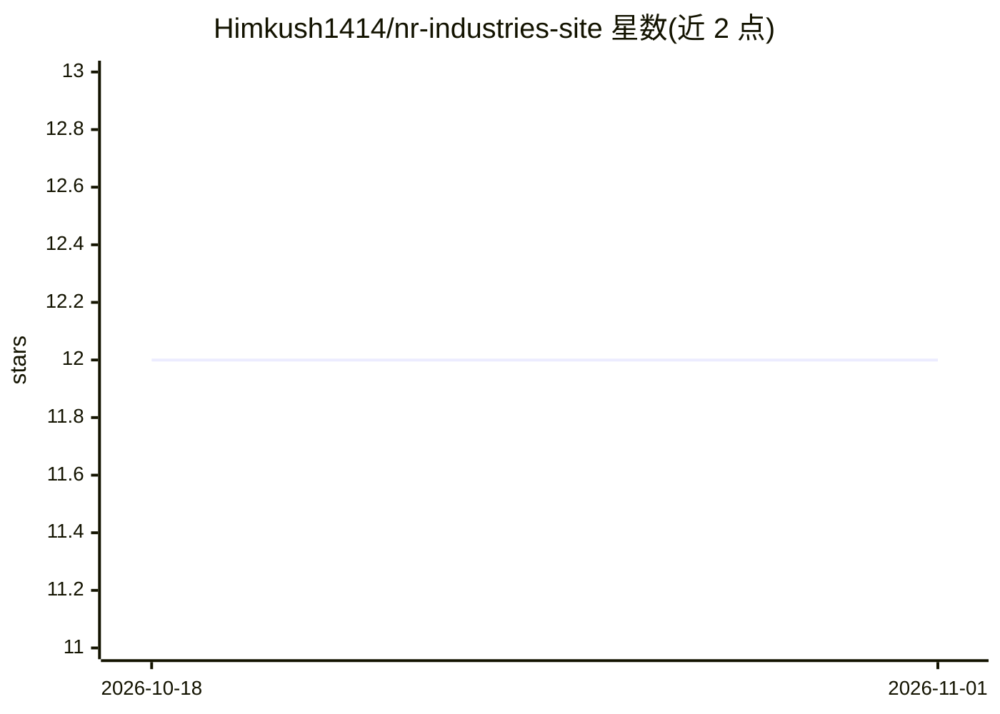

# Himkush1414/nr-industries-site

⭐ 12 · TypeScript · 推送 2026-09-27 · [GitHub](https://github.com/Himkush1414/nr-industries-site) · [官网](https://nrpower.in) · 个人维护

**变压器制造商 N R Industries 的企业官网源码（React+Supabase）**

面向印度喜马偕尔邦电力设备制造商 N R Industries 的多页营销与线索获取网站源码，展示产品目录、技术规格、所服务行业与认证，并通过联系表单、预约弹窗、WhatsApp/电话深链获客，表单后端为 Supabase。技术栈为 React 19、TypeScript、Vite、Tailwind CSS v4、GSAP、Recharts，部署于 Vercel。非 AI 项目：无任何模型或 AI 功能。个人独立开发并上线。

## 筛选速览

| 维度 | 判定 | 备注 |
|---|---|---|
| AI 角色 | `ai-enhanced` | 去掉 AI 部分产品仍成立 |
| 许可风险 | `none` | — |
| 部署形态 | `library` | 以包/库形式分发 |
| 模型依赖 | — | README 未给出锁定关系 |
| 硬件要求 | — | 无带数字的原话,不猜 |
| 安装摩擦 | `low` | 无编译、无系统依赖或容器化 |
| 成熟度 | — | 结构信号不足 |

## 能力要点

- 滚动驱动的首页 hero 动画（尊重 prefers-reduced-motion）
- Supabase 后端联系表单与预约弹窗、WhatsApp/电话线索通道
- JSON-LD 结构化数据、站点地图与 robots.txt 的 SEO 配置
- 路由级代码分割与懒加载媒体的性能处理

## 适用场景

- 查看企业官网的完整实现并本地运行
- 参考营销站点的表单线索管道与 SEO 实践
- 作为 Vercel + Vite + Supabase 的部署样例

## 场景标签

 · 领域:电力设备制造/企业官网

## 证据(README 行号)

> L10: The official corporate website for **N R Industries**, a manufacturer of power and distribution transformers, compa
> L20: The site is a full multi-page marketing and lead-generation platform for N R Industries — built to present the comp
> L152: Built solo, top to bottom, by **Manik Rana**.

## 星数曲线

2026-10-18 12 → 2026-11-01 12（+0）

---
*卡片 v1 · prompt 1.4 · 生成 2026-11-01 · 置信度 high · 依据 README sha `69228c80c705` · [字段定义](../../DATASET.md)*
