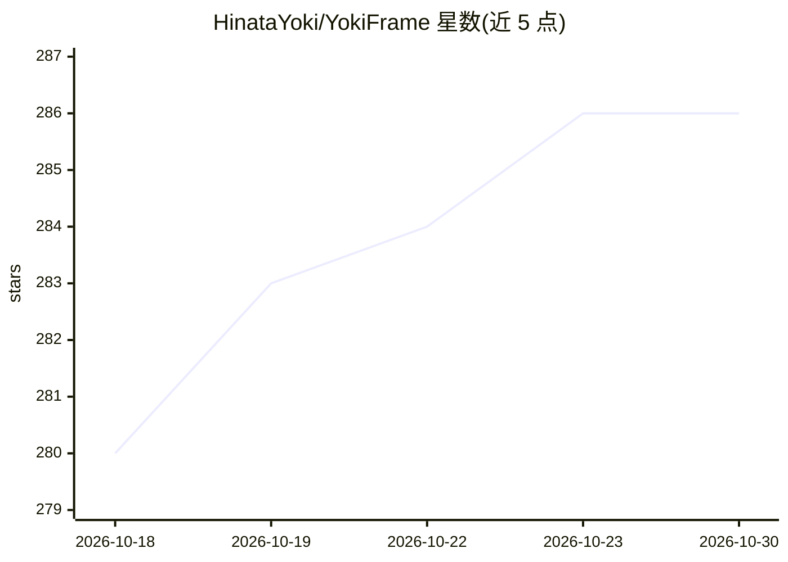

# HinataYoki/YokiFrame

⭐ 286 · C# · MIT · 推送 2026-10-19 · [GitHub](https://github.com/HinataYoki/YokiFrame) · 个人维护 · 中文 README

**面向 Unity/Godot .NET 的跨引擎 C# 游戏开发框架**

一套装入 Unity 或 Godot .NET 后可直接调用的 C# 游戏框架：业务代码写在纯 C# Core，引擎差异由宿主 Adapter 隔离，同一套代码跨引擎使用。能力拆分为可独立组合的 Kit（事件、状态机、对象池、资源、音频、存档、本地化、Unity UI 等），无必须第三方依赖，无全局初始化仪式。配套 Avalonia Workbench 可视化工具、yoki CLI 与图形化 Installer，并提供把仓库交给 AI 自动完成安装的流程；诊断通道为编辑器与 AI 工具设计。基于 QFramework 演化。

## 筛选速览

| 维度 | 判定 | 备注 |
|---|---|---|
| AI 角色 | `ai-enhanced` | 去掉 AI 部分产品仍成立 |
| 许可风险 | `permissive` | MIT |
| 部署形态 | `None` |  |
| 模型依赖 | — | README 未给出锁定关系 |
| 硬件要求 | — | 无带数字的原话,不猜 |
| 安装摩擦 | `medium` | 含编译或系统依赖之一 |
| 成熟度 | — | 结构信号不足 |

## 能力要点

- 业务代码纯 C#，Unity 与 Godot .NET 通用，Adapter 隔离宿主差异
- 无必须第三方依赖，无全局初始化，Kit 可单独使用或组合
- Avalonia Workbench、yoki CLI、Installer 图形化工具链
- 支持把安装流程交给 AI 自动完成编译与校验

## 适用场景

- 在 Unity 或 Godot .NET 项目中直接使用事件、状态机、对象池等游戏基础能力
- 希望同一套 C# 业务代码跨 Unity 与 Godot 引擎复用
- 通过 AI 工具自动完成框架安装与结果校验

## 场景标签

 · 领域:游戏开发框架

## 证据(README 行号)

> L3: **面向 Unity 与 Godot .NET 的跨引擎 C# 游戏框架**
> L12: **YokiFrame** 是一套装进 Unity 或 Godot .NET 后就能直接调用的跨引擎 C# 游戏框架。它没有必须安装的第三方库，也不需要先搭建运行时上下文：安装并完成编译后，直接使用 `EventKit`、`Log
> L14: 它把游戏开发中最常见的基础工作拆成一组可独立组合的 Kit：组织业务服务、传递事件、管理状态、编排流程、加载资源、播放音频、保存数据、处理本地化和搭建 Unity UI。业务规则写在纯 C# Core 中，引擎 API、生命周期与
> L68: 不想手动操作时，直接把本仓库地址（或本地源码包目录）和“安装 YokiFrame”一起交给 AI 即可。AI 会自动完成编译、Runtime 构建、安装计划与结果校验，详细流程见 AI 安装指引。

## 星数曲线

2026-10-18 280 → 2026-10-30 286（+6）

---
*卡片 v1 · prompt 1.4 · 生成 2026-10-22 · 置信度 high · 依据 README sha `6a78dbb1b4be` · [字段定义](../../DATASET.md)*
