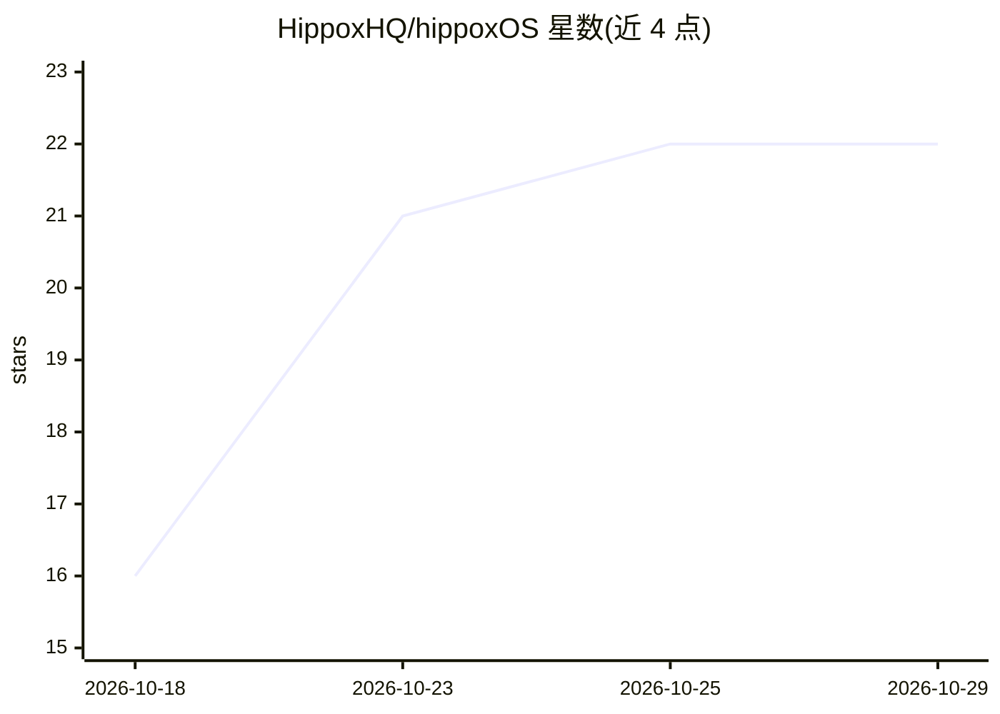

# HippoxHQ/hippoxOS

⭐ 22 · TypeScript · AGPL-3.0 · 推送 2026-10-24 · [GitHub](https://github.com/HippoxHQ/hippoxOS) · [官网](https://hippoxos.vercel.app) · 组织维护 · 中文 README

**以自然语言为核心交互的 AI 原生桌面操作系统**

基于 Tauri 的 AI 原生桌面操作系统，由自研 Hippox Kernel 作为调度引擎，将自然语言意图解析为系统可执行指令，编排驱动程序、工作流与系统资源访问。内置通用对话子系统（ReAct/Batch/Chain/PlanAndExecute 四种工作流模式）以及视频编辑、像素动画、3D 沙盒、地理信息、金融分析、代码开发、容器管理等专业子系统；视频子系统含 NLE 引擎、屏幕录制、绘图画布与多模态模型媒体生成。提供 Windows/macOS/Linux 安装包，面向希望用对话驱动专业软件的终端用户。

## 筛选速览

| 维度 | 判定 | 备注 |
|---|---|---|
| AI 角色 | `ai-native` | 本体是模型或模型工具 |
| 许可风险 | `viral` | AGPL-3.0 |
| 部署形态 | `desktop` | 安装包/桌面程序 |
| 模型依赖 | — | README 未给出锁定关系 |
| 硬件要求 | — | 无带数字的原话,不猜 |
| 安装摩擦 | `low` | 无编译、无系统依赖或容器化 |
| 成熟度 | — | 结构信号不足 |

## 能力要点

- 自研 Hippox Kernel 编排语言模型能力、驱动与资源访问控制
- 自然语言驱动视频剪辑（NLE 引擎、多机位、关键帧动画、实时预览）
- 四种工作流模式：ReAct / Batch / Chain / PlanAndExecute
- 集成屏幕/摄像头录制、绘图画布与定时自动化任务

## 适用场景

- 用自然语言描述意图完成视频剪辑等专业任务
- 通过对话管理文件、容器、代码等系统资源
- 设置定时任务让自然语言指令自动执行

## 场景标签

`金融量化` `视频生成` `AI 助手` · 领域:对话与助手

## 证据(README 行号)

> L5: A native LLM operating system.
> L62: HippoxOS is an AI-native desktop operating system. It is not a collection of applications in the traditional sense,
> L66: In HippoxOS, natural language is no longer merely an input form for chatbots; it is elevated to the primary interfa

## 星数曲线

2026-10-18 16 → 2026-10-29 22（+6）

---
*卡片 v1 · prompt 1.4 · 生成 2026-10-27 · 置信度 mid · 依据 README sha `c81ccf45e696` · [字段定义](../../DATASET.md)*
