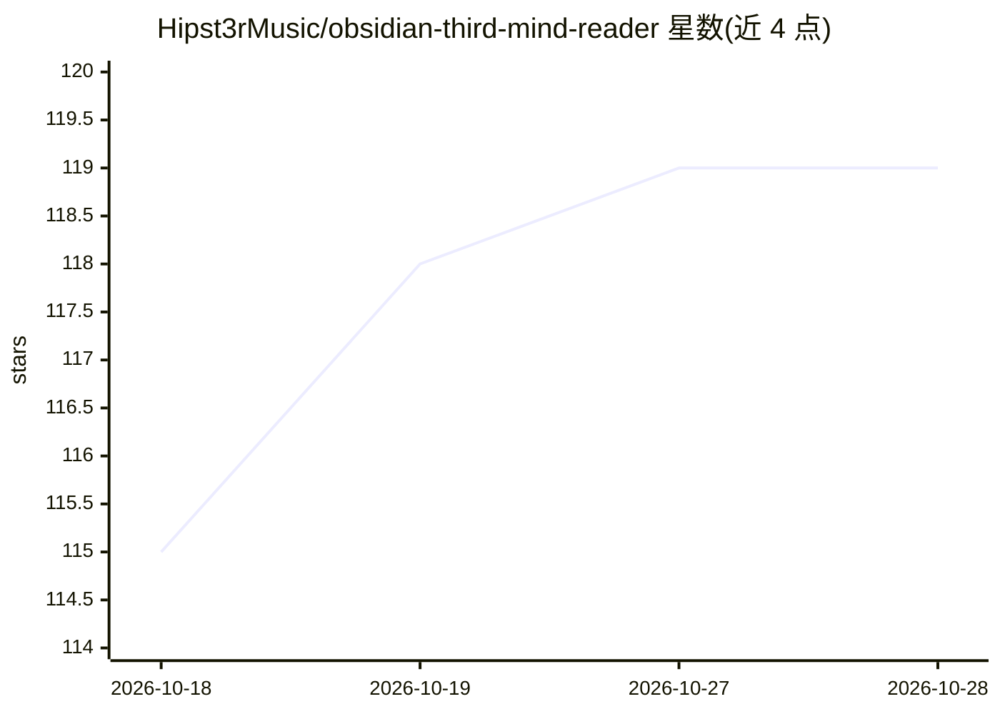

# Hipst3rMusic/obsidian-third-mind-reader

⭐ 120 · TypeScript · AGPL-3.0 · 推送 2026-10-27 · [GitHub](https://github.com/Hipst3rMusic/obsidian-third-mind-reader) · 个人维护

**Obsidian 中的 EPUB/PDF 阅读器，高亮存为 markdown，AI 聊天可选**

面向 Obsidian 用户的 EPUB 与 PDF 阅读插件：书籍以标签页打开，选中文字弹出 Gloss 工具栏进行高亮与批注，每本书生成一个 companion note，批注以 markdown callout 形式写入 vault 并链接回原文。AI 功能默认关闭，配置 provider 后可对选中段落发起解释、深挖、多轮对话等四种模式，对话记录完整写入笔记；支持 Ollama、LM Studio 本地模型及 Anthropic、OpenAI、OpenRouter 云服务（自带 key）。不配置 AI 时以 Lite 模式运行，仅保留纯高亮。仅支持无 DRM 的 EPUB，移动端完整可用但 Android 测试较少。

## 筛选速览

| 维度 | 判定 | 备注 |
|---|---|---|
| AI 角色 | `ai-enhanced` | 去掉 AI 部分产品仍成立 |
| 许可风险 | `viral` | AGPL-3.0 |
| 部署形态 | `None` |  |
| 模型依赖 | local-ok | 支持本地模型 |
| 硬件要求 | — | 无带数字的原话,不猜 |
| 安装摩擦 | `low` | 无编译、无系统依赖或容器化 |
| 成熟度 | `idea` | |

## 能力要点

- 高亮/批注以纯 markdown 写入 vault，反链接到原书，参与 graph view
- AI 默认关闭，Lite 模式无 AI 运行；接入 provider 后提供 4 种 AI 模式
- 支持 Ollama / LM Studio 本地推理，云端需自带 key
- 移动端延迟 AI：手机上提出的问题在桌面端打开该书时由本地模型回答

## 适用场景

- 在 Obsidian 内阅读 EPUB/PDF 并把批注留在自己笔记库
- 阅读时对选中段落即时发起 AI 解释或深挖对话
- 本地模型完成推理，不把书中内容发送到云端

## 场景标签

`知识库管理` `文档问答` · 领域:知识与检索

## 证据(README 行号)

> L47: **If you don't want AI anywhere near your reading, you don't have to have it.** AI is off until you add a provider,
> L71: **Local first.** Point it at Ollama or LM Studio and nothing ever leaves your machine. Cloud providers (Anthropic, 

## 星数曲线

2026-10-18 115 → 2026-10-28 119（+4）

---
*卡片 v1 · prompt 1.4 · 生成 2026-10-23 · 置信度 high · 依据 README sha `1f009246446c` · [字段定义](../../DATASET.md)*
