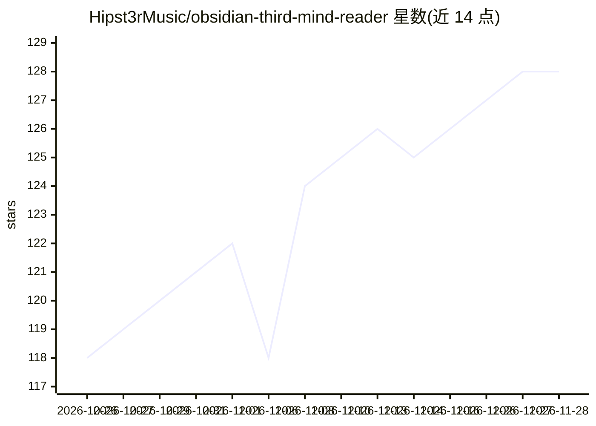

# Hipst3rMusic/obsidian-third-mind-reader

⭐ 128 · TypeScript · AGPL-3.0 · 推送 2026-10-27 · [GitHub](https://github.com/Hipst3rMusic/obsidian-third-mind-reader) · 个人维护

**Obsidian 的 EPUB/PDF 阅读插件：标注与 AI 问答，AI 可选**

以 Obsidian 插件形式提供的 EPUB 与 PDF 阅读器：书籍以标签页打开，支持双页/单页排版、章节导航、全书搜索、进度记忆与书签；划选文本弹出 Gloss 工具栏生成标注，标注以纯 markdown 伴随笔记写入 vault 并回链原书。AI 部分默认关闭，配置 provider 后开放对话式标注（解释/追问等模式），支持本地（Ollama、LM Studio）与云端（Anthropic、OpenAI、OpenRouter），无 provider 时以 Lite 模式运行。仅支持无 DRM 书籍，源 EPUB 不被修改。

## 筛选速览

| 维度 | 判定 | 备注 |
|---|---|---|
| AI 角色 | `ai-enhanced` | 去掉 AI 部分产品仍成立 |
| 许可风险 | `viral` | AGPL-3.0 |
| 部署形态 | `None` |  |
| 模型依赖 | local-ok | 支持本地模型 |
| 硬件要求 | — | 无带数字的原话,不猜 |
| 安装摩擦 | `low` | 无编译、无系统依赖或容器化 |
| 成熟度 | `idea` | |

## 能力要点

- 标注以纯 markdown 伴随笔记写入 vault，卸载插件后仍可读
- Gloss 工具栏五种模式，无 AI 时保留纯高亮 Lite 模式
- 支持本地推理（Ollama/LM Studio）与云端 provider（自带 API key）
- 桌面与移动端完整支持，移动端可延迟到桌面本地模型回答

## 适用场景

- 在 Obsidian 内阅读 EPUB/PDF 并将批注沉淀为笔记
- 阅读时对选中段落发起 AI 解释与追问
- 保持推理本地化、数据不出本机的标注工作流

## 场景标签

`知识库管理` `文档问答` · 领域:知识与检索

## 证据(README 行号)

> L5: An opinionated EPUB & PDF reader for Obsidian. Books open as tabs like anything else in your vault, designed to be m
> L19: I thought the act of annotation can look different too, with the technologies available to us now. Which is why I c
> L47: **If you don't want AI anywhere near your reading, you don't have to have it.** AI is off until you add a provider,
> L73: **Local first.** Point it at Ollama or LM Studio and nothing ever leaves your machine. Cloud providers (Anthropic, 

## 星数曲线

2026-10-26 118 → 2026-11-28 128（+10）

---
*卡片 v1 · prompt 1.4 · 生成 2026-11-28 · 置信度 high · 依据 README sha `8082ed09bfa6` · [字段定义](../../DATASET.md)*
