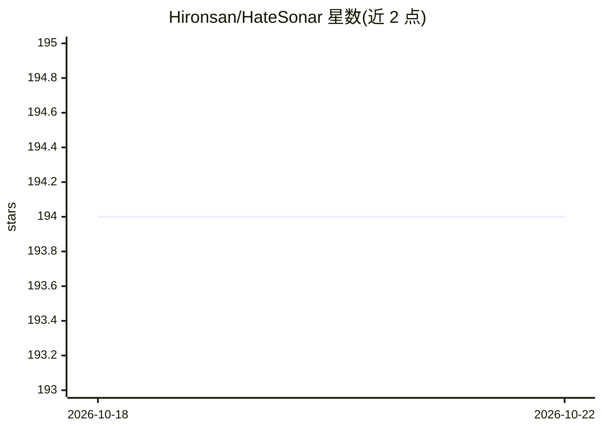

# Hironsan/HateSonar

⭐ 194 · Jupyter Notebook · MIT · 推送 2025-10-26 · [GitHub](https://github.com/Hironsan/HateSonar) · 个人维护

**Python 仇恨言论检测库：无需训练直接输出文本判定**

面向 Python 开发者的仇恨言论与冒犯性语言检测库。内置基于 BERT 的模型，用户无需自行训练，将文本传入 Sonar 即可得到仇恨言论/冒犯性语言/无问题的分类判定与置信度分数。以 pip 包形式提供，官方支持 Python 3.10+。所依据数据集来自 Davidson 等人 2017 年 ICWSM 论文，主要覆盖英文文本场景。

## 筛选速览

| 维度 | 判定 | 备注 |
|---|---|---|
| AI 角色 | `ai-native` | 本体是模型或模型工具 |
| 许可风险 | `permissive` | MIT |
| 部署形态 | `library` | 以包/库形式分发 |
| 模型依赖 | — | README 未给出锁定关系 |
| 硬件要求 | — | 无带数字的原话,不猜 |
| 安装摩擦 | `low` | 无编译、无系统依赖或容器化 |
| 成熟度 | — | 结构信号不足 |

## 能力要点

- 无需训练，直接输入文本即可检测
- 基于 BERT 的模型
- 输出分类结果与置信度分数
- 支持 Python 3.10+

## 适用场景

- 审核社区或用户生成文本中的仇恨言论
- 给现有 Python 应用加内容安全检测
- 构建内容分类流水线

## 场景标签

 · 领域:NLP/内容审核

## 证据(README 行号)

> L14: HateSonar allows you to detect hate speech and offensive language in text, without the need for training. There's n
> L16: BERT based model

## 星数曲线

2026-10-18 194 → 2026-10-22 194（+0）

---
*卡片 v1 · prompt 1.4 · 生成 2026-10-22 · 置信度 high · 依据 README sha `33a1779ad7b0` · [字段定义](../../DATASET.md)*
