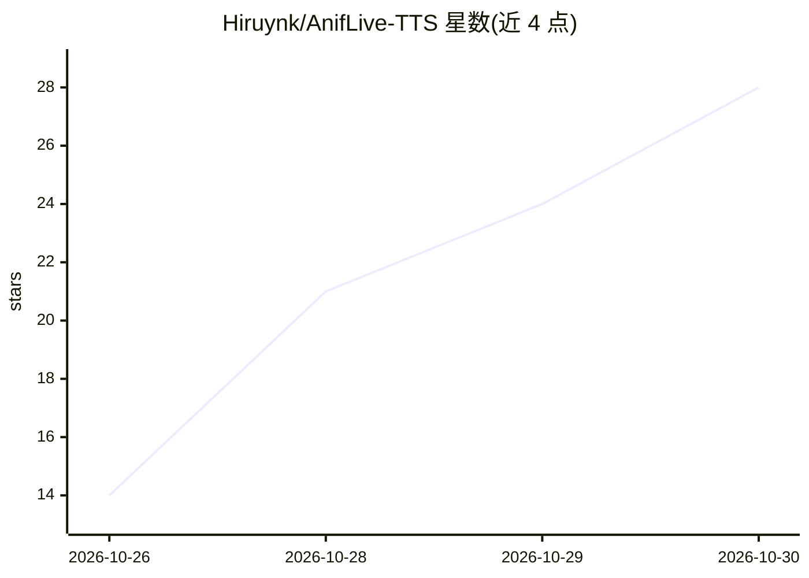

# Hiruynk/AnifLive-TTS

⭐ 28 · Python · NOASSERTION · 推送 2026-10-09 · [GitHub](https://github.com/Hiruynk/AnifLive-TTS) · [官网](http://demo.aniflive-tts-studio.diurnoctra.com) · 个人维护 · 中文 README

**基于 GPT-SoVITS 的低延迟多语言语音克隆 TTS 运行时，粤语优先**

AnifEngine-Voice 的第一方 TTS 运行时，以 GPT-SoVITS 为基础重写推理内核：九个神经阶段全部经 TensorRT 11 execute_async_v3() 执行，配合持久化 TensorRT 上下文、固定 KV 缓冲与采样 CUDA Graph。支持中/粤/英/日/韩五语，打包 GPT/SoVITS 检查点与参考音频为独立音色包（v1 支持 V2ProPlus），提供完整 WAV 与 PCM16 流式两种输出，附 OpenAI 兼容适配器、本地五语 WebUI 与基准脚本。需 NVIDIA GPU（CUDA/TensorRT），基准环境为 RTX 5070 Ti。

## 筛选速览

| 维度 | 判定 | 备注 |
|---|---|---|
| AI 角色 | `ai-native` | 本体是模型或模型工具 |
| 许可风险 | `none` | NOASSERTION |
| 部署形态 | `desktop` | 安装包/桌面程序 |
| 模型依赖 | — | README 未给出锁定关系 |
| 硬件要求 | — | 无带数字的原话,不猜 |
| 安装摩擦 | `medium` | 含编译或系统依赖之一 |
| 成熟度 | — | 结构信号不足 |

## 能力要点

- 九个神经阶段全部经 TensorRT 11 execute_async_v3() 执行，FP16
- 中/粤/英/日/韩五语，GPT-SoVITS V2ProPlus 音色克隆打包为独立音色包
- 完整 WAV 与低延迟 PCM16 流式共享同一运行时，提供 OpenAI 兼容适配器
- 本地五语 WebUI：模型切换、表达选择、流式播放与实时延迟指标

## 适用场景

- 自托管低延迟语音克隆服务，需 NVIDIA GPU 环境
- 粤语/多语言实时流式 TTS，如虚拟主播或直播语音
- 通过 OpenAI 兼容 API 接入现有应用的语音合成

## 场景标签

`语音合成` · 领域:内容生成

## 证据(README 行号)

> L5: **A low-latency, high-quality multilingual voice-cloning TTS runtime with first-class Cantonese support**
> L25: - All nine neural stages use TensorRT 11 `execute_async_v3()`.
> L28: - Complete mono PCM16 WAV and low-latency PCM16 streaming share one runtime.

## 星数曲线

2026-10-26 14 → 2026-10-30 28（+14）

---
*卡片 v1 · prompt 1.4 · 生成 2026-10-28 · 置信度 high · 依据 README sha `bfff9fe28f13` · [字段定义](../../DATASET.md)*
