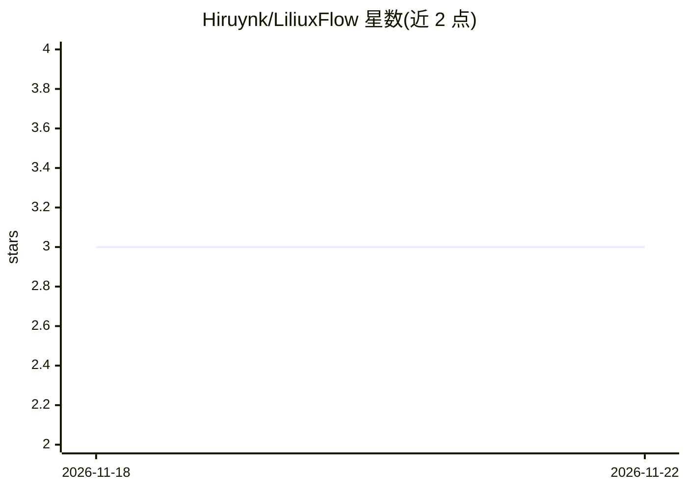

# Hiruynk/LiliuxFlow

⭐ 3 · Python · Apache-2.0 · 推送 2026-10-12 · [GitHub](https://github.com/Hiruynk/LiliuxFlow) · [官网](https://liliuxflow.diurnoctra.com) · 个人维护 · 中文 README

**Apple Silicon 上的本地 LLM 服务编排栈：推理+API 管理+模型生命周期**

面向 macOS Apple Silicon 的本地 LLM 服务与运维平台，将 Lily 推理、LiteLLM API 访问管理与 llama-swap 模型进程管理整合为一个可部署栈，并提供协议适配层。按请求感知的方式协调模型加载、卸载与取消；为各应用签发 LiteLLM virtual key 并控制模型权限、用量与限速；提供 OpenAI 兼容 Chat Completions 端点与多语言仪表盘。依赖 macOS arm64 主机、uv/Rust/PostgreSQL 等前置条件，默认模型约 98 GiB 需另行下载，其余 Apple Silicon 配置未经验证。

## 筛选速览

| 维度 | 判定 | 备注 |
|---|---|---|
| AI 角色 | `ai-ecosystem` | LLM/agent 周边工具 |
| 许可风险 | `permissive` | Apache-2.0 |
| 部署形态 | `None` |  |
| 模型依赖 | — | README 未给出锁定关系 |
| 硬件要求 | — | 无带数字的原话,不猜 |
| 安装摩擦 | `low` | 无编译、无系统依赖或容器化 |
| 成熟度 | — | 结构信号不足 |

## 能力要点

- 整合 Lily 推理、LiteLLM API 管理与 llama-swap 模型进程管理
- LiteLLM virtual key 实现按应用的密钥、权限、用量与限速管理
- llama-swap 按需加载/空闲卸载，生命周期保护与跨层取消传递
- 提供 64K/128K/262K 上下文档位与可选 MTP2 共享常驻模式

## 适用场景

- 在 Mac 上为本地应用搭建 OpenAI 兼容的模型 API 服务
- 按应用分发独立 API key 并跟踪用量与限流
- 管理长上下文模型的加载、切换与日常运维备份

## 场景标签

`模型网关` `推理引擎` · 领域:Agent 开发

## 证据(README 行号)

> L14: LiliuxFlow is a native local LLM serving and operations platform for Apple Silicon. It brings Lily inference, LiteL
> L16: LiliuxFlow adds service orchestration, request-aware lifecycle protection and protocol adaptation around these comp
> L50: |API management|LiteLLM|Model routing, caller-key setup and multilingual dashboard integration|

## 星数曲线

2026-11-18 3 → 2026-11-22 3（+0）

---
*卡片 v1 · prompt 1.4 · 生成 2026-11-22 · 置信度 high · 依据 README sha `fc0a5319b950` · [字段定义](../../DATASET.md)*
