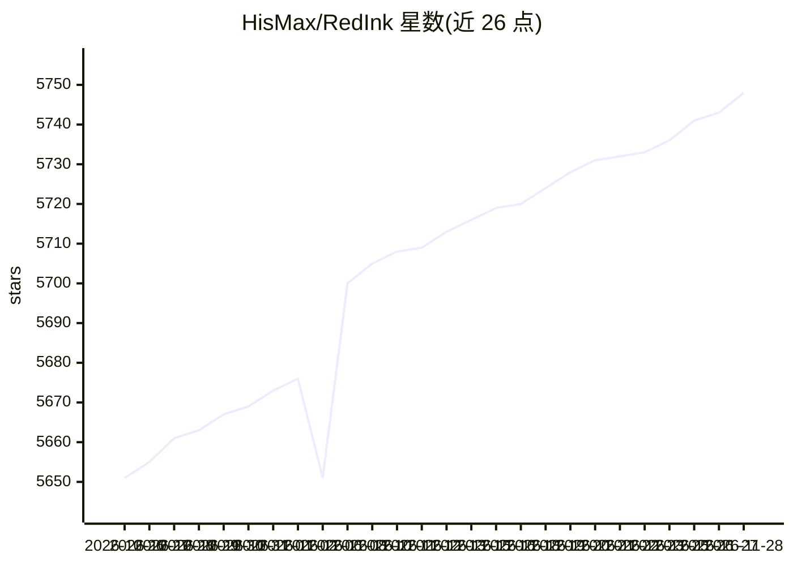

# HisMax/RedInk

⭐ 5,748 · Python · NOASSERTION · 推送 2026-11-27 · [GitHub](https://github.com/HisMax/RedInk) · [官网](https://redink.top) · 个人维护 · 中文 README

**面向小红书创作者的一句话生成图文内容的工具**

基于 Flask（Python 3.11+）与 Vue 3 的 Web 应用，流程分三步：生成大纲（可逐页编辑、排序与自定义描述）、生成封面页、并发批量生成内容页（默认最多 15 页，可单页重绘）。文本生成接 Gemini 与 OpenAI 兼容 API，图像生成接 Nano Banana Pro 及兼容图像 API。通过 Docker 镜像或本地源码运行，API Key 在 Web 设置页或 YAML 文件中配置，支持历史记录持久化。许可证为 CC BY-NC-SA 4.0，商用需联系作者获取商业授权。

## 筛选速览

| 维度 | 判定 | 备注 |
|---|---|---|
| AI 角色 | `ai-native` | 本体是模型或模型工具 |
| 许可风险 | `none` | NOASSERTION |
| 部署形态 | `self-host` | docker 或自建部署 |
| 模型依赖 | — | README 未给出锁定关系 |
| 硬件要求 | — | 无带数字的原话,不猜 |
| 安装摩擦 | `low` | 无编译、无系统依赖或容器化 |
| 成熟度 | — | 结构信号不足 |

## 能力要点

- 一句话生成大纲、封面与内容页三步式小红书图文流程
- 并发批量生成（默认最多 15 页），可单页重绘且复用已有图像避免重复消耗配额
- 文本支持 Google Gemini 与 OpenAI 兼容 API，图像支持兼容 API 自动适配
- Web UI 或 YAML 两种方式配置 API 提供商，历史记录可持久化

## 适用场景

- 一句话生成小红书风格的封面与图文内容
- 批量制作风格统一的系列社交媒体配图
- 本地或自托管部署后按自身 API 配额管理生成任务

## 场景标签

`图像生成` `AI 写作` · 领域:内容生成

## 证据(README 行号)

> L24: ### Type One Sentence, Get Complete Image & Text Posts
> L62: |**Text AI**|Gemini 3|
> L63: |**Image AI**|🍌 Nano Banana Pro|

## 星数曲线

2026-10-26 5,651 → 2026-11-28 5,748（+97）

---
*卡片 v1 · prompt 1.4 · 生成 2026-11-28 · 置信度 mid · 依据 README sha `78826cdc1953` · [字段定义](../../DATASET.md)*
