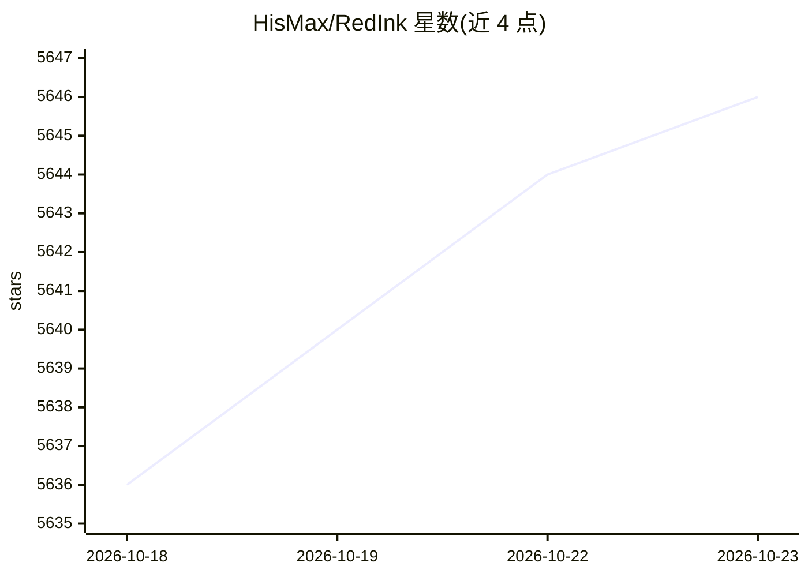

# HisMax/RedInk

⭐ 5,646 · Python · NOASSERTION · 推送 2026-06-30 · [GitHub](https://github.com/HisMax/RedInk) · [官网](https://redink.top) · 个人维护 · 中文 README

**一句话生成小红书图文帖的 Web 应用（封面+内页+文案）**

面向内容创作者的自托管 Web 应用：用户输入一句话，先生成可编辑的大纲，再基于 Nano Banana Pro 图像模型与 Gemini 3 文本模型批量生成风格一致的封面与内页图，支持逐页重绘、并发生成（默认最多 15 张）与文案（标题/正文/标签）生成。后端 Flask（Python 3.11+，uv），前端 Vue 3 + TypeScript。图像与文本提供商通过 YAML 或 Web UI 配置 API Key，支持 Gemini 与 OpenAI 兼容 API。提供 Docker 镜像一键部署，本地开发需 Python/Node.js/pnpm/uv。个人使用为 CC BY-NC-SA 4.0，商业用途需联系作者获取商业许可。

## 筛选速览

| 维度 | 判定 | 备注 |
|---|---|---|
| AI 角色 | `ai-native` | 本体是模型或模型工具 |
| 许可风险 | `none` | NOASSERTION |
| 部署形态 | `self-host` | docker 或自建部署 |
| 模型依赖 | — | README 未给出锁定关系 |
| 硬件要求 | — | 无带数字的原话,不猜 |
| 安装摩擦 | `low` | 无编译、无系统依赖或容器化 |
| 成熟度 | — | 结构信号不足 |

## 能力要点

- 一句话→大纲→封面+内页图的分步生成流程，大纲可编辑与重排
- 文本支持 Gemini 与 OpenAI 兼容 API 自动切换，图像支持 GPT Image 与 Nano Banana 兼容 API
- 批量并发生成（默认最多 15 张）与单页重绘，重绘保持风格一致
- Docker 单容器部署，历史记录与生成图片可持久化挂载

## 适用场景

- 快速产出小红书风格的图文帖子
- 批量生成风格一致的封面和内页配图
- 自动生成帖子标题、正文与标签文案

## 场景标签

`图像生成` `AI 写作` · 领域:内容生成

## 证据(README 行号)

> L18: ### Type One Sentence, Get Complete Image & Text Posts
> L56: |**Text AI**|Gemini 3|
> L57: |**Image AI**|🍌 Nano Banana Pro|

## 星数曲线

2026-10-18 5,636 → 2026-10-23 5,646（+10）

---
*卡片 v1 · prompt 1.4 · 生成 2026-10-20 · 置信度 mid · 依据 README sha `5978ca835151` · [字段定义](../../DATASET.md)*
