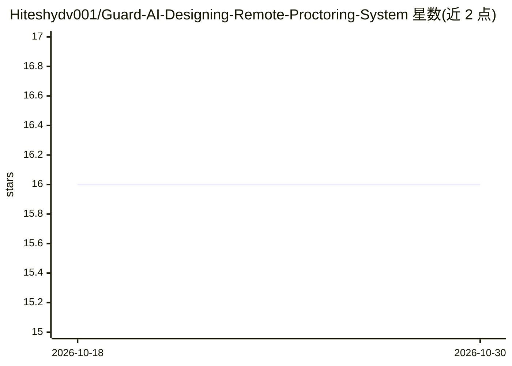

# Hiteshydv001/Guard-AI-Designing-Remote-Proctoring-System

⭐ 16 · TypeScript · 推送 2026-02-11 · [GitHub](https://github.com/Hiteshydv001/Guard-AI-Designing-Remote-Proctoring-System) · [官网](https://hiteshydv001.github.io/Guard-AI-Designing-Remote-Proctoring-System/) · 组织维护

**面向远程考试的 AI 监考系统：检测作弊行为并生成报告**

开源的 AI 远程监考系统，用于在线考试的场景监控。通过机器学习实现眼球与嘴唇动作检测、面部情绪识别、实时屏幕活动分析、语音转文字音频校验，并扫描 Wi-Fi/蓝牙信号与端口以识别未授权设备。后端基于 Python/FastAPI，前端使用 HTML/CSS/JavaScript，数据存于 MongoDB。README 中的架构、技术栈、用途部分内容不完整；给出 git fork/branch 的贡献流程，未给出面向最终用户的安装运行命令。提供社区演示视频入口与 Vercel 项目站点。

## 筛选速览

| 维度 | 判定 | 备注 |
|---|---|---|
| AI 角色 | `ai-native` | 本体是模型或模型工具 |
| 许可风险 | `none` | — |
| 部署形态 | `None` |  |
| 模型依赖 | — | README 未给出锁定关系 |
| 硬件要求 | — | 无带数字的原话,不猜 |
| 安装摩擦 | `low` | 无编译、无系统依赖或容器化 |
| 成熟度 | — | 结构信号不足 |

## 能力要点

- 眼球与嘴唇动作检测、面部情绪识别
- 实时屏幕活动分析与语音转文字校验
- Wi-Fi/蓝牙信号扫描与端口异常检测
- FastAPI 后端 + MongoDB 存储

## 适用场景

- 在线考试中对考生进行行为监控与作弊检测
- 考试后查看监考活动分析报告
- 教育与招聘等远程评估场景的监考

## 场景标签

`人脸识别` `语音识别` `目标检测` · 领域:感知与多模态

## 证据(README 行号)

> L41: This project introduces a cutting-edge **AI-powered proctoring system** designed to maintain **fairness**, **securi
> L67:  Eyeball and Lips Movement Detection

## 星数曲线

2026-10-18 16 → 2026-10-30 16（+0）

---
*卡片 v1 · prompt 1.4 · 生成 2026-10-30 · 置信度 mid · 依据 README sha `bf46cc213d45` · [字段定义](../../DATASET.md)*
